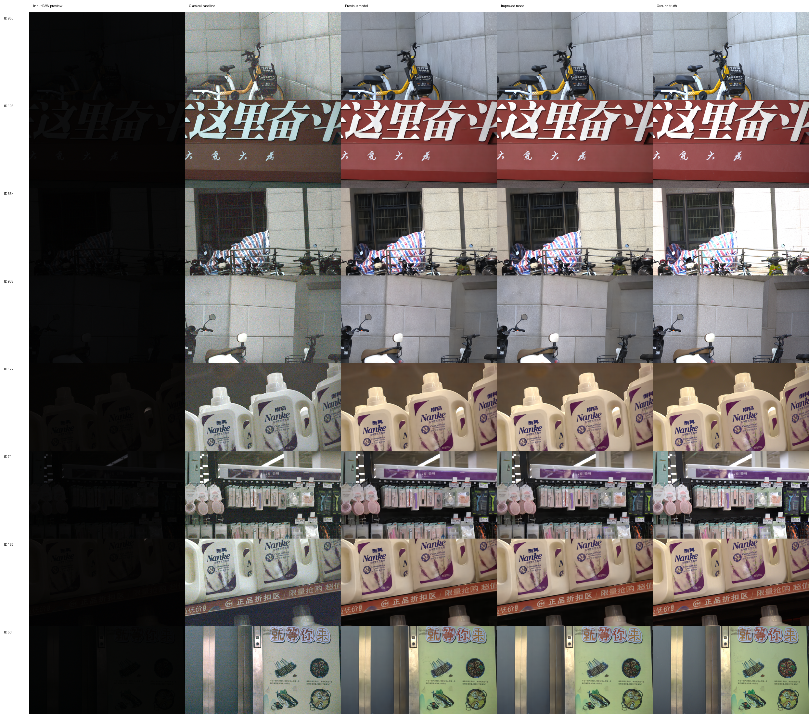
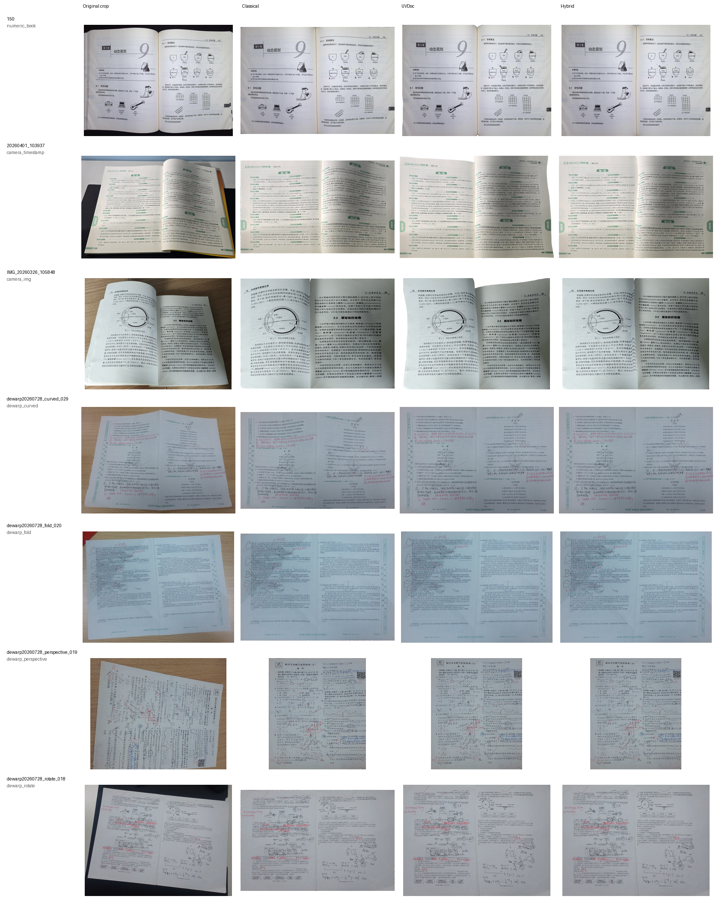
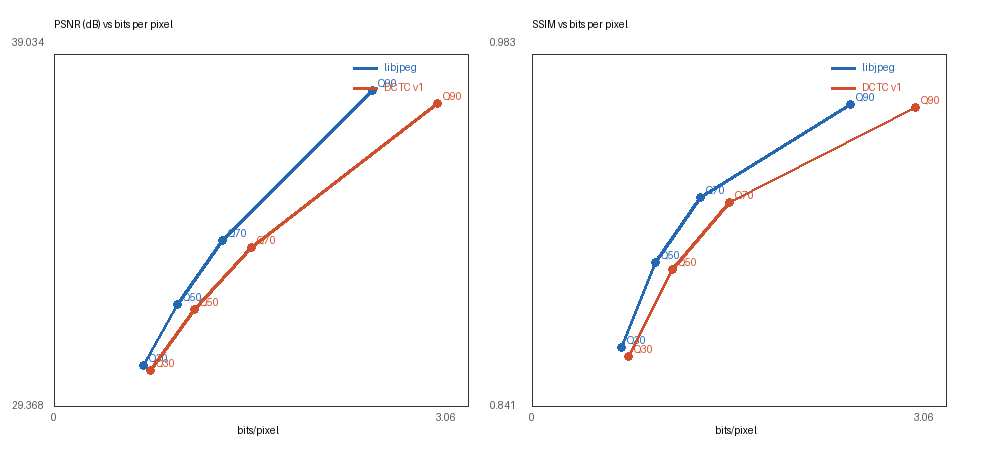
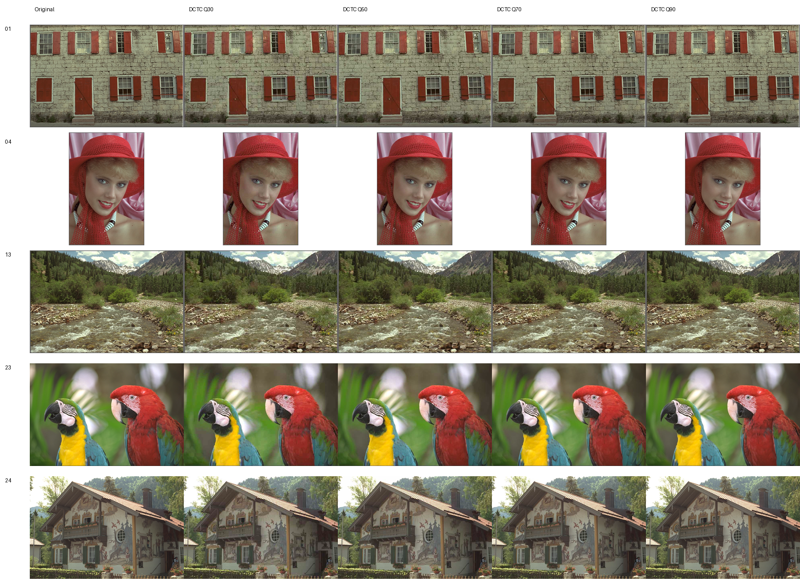

# 数字图像处理课程实习综合报告

姓名：__________  
学号：__________  
班级：__________  
完成日期：2026 年 10 月 14 日  
代码仓库：<https://github.com/xuntonghan/digital-image-proocess-work>

## 摘要

本项目完成了课程要求的三项任务：SIED 极暗 RAW 图像增强、GeoCorrection 文档几何校正和 Kodak 图像压缩。每个任务都包含数据读取与审计、可解释的传统基线、改进算法或学习模型、客观评价、可视化和命令行复现入口。

图像增强部分实现了自动传统 ISP、Residual U-Net、颜色感知改进、SIED ICCV 2025 作者模型盲推理适配器和受限曝光色调精修器。Canon 官方测试集上，最终方案达到 22.9060 dB PSNR 和 0.7861 SSIM；Sony 子集上的自研 U-Net 达到 17.0517 dB 和 0.6332 SSIM。几何校正部分实现了单应性与边界展平、UVDoc 稠密展平和两者组合的混合方案。混合方案将文本行平均倾斜角从 7.597° 降至 5.113°，40 张固定 OCR 子集的高置信字符数提升 22.03%。图像压缩部分建立了 libjpeg 基线，并实现独立的 DCTC v1 码流。DCTC Q70 在 Kodak 24 图上实现 8.965 倍 PNG 文件压缩比、33.740 dB PSNR 和 0.9237 SSIM。

所有最终数字都有逐图 CSV 和汇总 JSON 支持。仓库保留源码、数据清单、配置、评价结果和代表图；原始数据、大型预训练权重和全量中间结果因体积和分发限制不提交到 Git，复现时必须另行放入指定目录。

**关键词**：极暗 RAW 增强；文档展平；UVDoc；OCR；DCT；图像压缩；可复现实验

## 1 任务要求与完成状态

课件要求对 SIED、GeoCorrection 和 Kodak 数据分别完成图像增强、文档几何校正和图像压缩，并提交可复现源码、部署文档、实验报告、客观指标和前后对比图。表 1 汇总当前完成情况。

| 任务 | 课程核心要求 | 已完成内容 | 状态 |
|---|---|---|---|
| 图像增强 | 数据读取、模型设计、增强、PSNR、SSIM、LPIPS、可视化 | 2000 对 RAW/GT 审计；传统 ISP；U-Net；SIED 官方模型；色调精修；原分辨率评价 | 已完成，Sony 官方 SIED 权重尚可补充 |
| 几何校正 | 倾斜、透视和曲面校正；规整度和 OCR 评价 | 200 对审计；传统校正；UVDoc；混合精修；40 张 OCR 诊断 | 已完成 oracle-mask 版本 |
| 图像压缩 | 读取、压缩、解压、压缩比、PSNR、SSIM、时间 | libjpeg 基线；自研 DCTC v1；24 图多码率评价；率失真曲线 | 已完成 |
| 工程交付 | 源码、部署文档、报告和可视化 | Python 包、CLI、配置、清单、测试、云端手册、逐图指标、汇总与代表图 | 已完成 |

## 2 项目结构与可复现设计

### 2.1 代码和实验版本

项目使用 Python 3.10 至 3.12，以 `pyproject.toml` 管理依赖和命令行入口。本报告对应的已验证实验代码基线是 Git 提交 `ce132d96da2b9af102b8578b42769468f4065387`。训练集、验证集和测试集由固定清单隔离，评价命令输出逐图 CSV 和机器可读 JSON。

仓库目录的用途如下：

| 目录 | 内容 | 是否建议提交 |
|---|---|---:|
| `src/dip_course/` | 核心算法、模型、指标和 CLI | 是 |
| `configs/` | 训练与消融配置 | 是 |
| `manifests/` | 数据划分、哈希和固定评价子集 | 是 |
| `tests/` | 数据、编解码、几何变换和模型回归测试 | 是 |
| `cloud/` | RTX 4090 环境检查、执行手册和权重精简工具 | 是 |
| `reports/` | 阶段报告、汇总指标和代表图 | 是 |
| `data/` | 课程数据集 | 否，需另行配置 |
| `checkpoints/` | 训练和预训练权重 | 否，体积大且存在分发条件 |
| `outputs/` | 全量输出和中间实验 | 否，可通过命令再生成 |

### 2.2 评价规则

本项目的核心评价原则是先固定数据划分和参数，再运行正式测试。SIED 保留官方测试集，只用训练集和验证集选权重；Kodak 使用全部 24 张图一次性比较所有质量档；GeoCorrection 因无平整真值，使用边界直线度、Hough 文本行倾斜度和固定 OCR 子集，不对几何位置已改变的输入和输出计算无物理意义的 PSNR/SSIM。

## 3 SIED 极暗 RAW 图像增强

### 3.1 数据读取与划分

使用 Canon `0.0001` 和 Sony `0.001` 两个子集，每个子集包含 1000 对低光 RAW 和高质量 sRGB 参考图。所有 RAW 均为 3840×2160、`uint16`，黑电平为 512，白电平为 16383。读取流程完成黑电平扣除、白电平归一化和 RGGB 四通道打包。

| 子集 | 训练 | 验证 | 官方测试 | 合计 |
|---|---:|---:|---:|---:|
| Canon | 832 | 92 | 76 | 1000 |
| Sony | 822 | 91 | 87 | 1000 |

划分清单对应 SIED 官方仓库提交 `fb7af94ac831e91c647415bf1ca0b1a75931833a`。验证集使用固定种子 `20260930` 从官方训练部分抽取，三个集合的 RAW 与 GT 路径互斥。

### 3.2 已实现方法

#### 3.2.1 自动传统 ISP

传统流程为黑电平校正、RGGB 去马赛克、灰世界白平衡、高分位数自动曝光、Gamma 映射和范围裁剪。每张图的白平衡和曝光只使用该张 RAW 统计量，不读取 GT。Canon 固定为 `gamma=2.0, percentile=98, target=0.9`，Sony 固定为 `gamma=1.8, percentile=99, target=0.9`。

#### 3.2.2 Residual U-Net

自研学习模型约有 1789 万参数，在半分辨率的四通道 RAW 空间处理，通过 PixelShuffle 2倍重建全分辨率 RGB。主训练使用 256×256 RAW patch、batch size 4、AdamW、`1e-4` 学习率和 FP16。损失由 RGB L1、SSIM 和 YCbCr 色度 L1 组成。4K 推理采用 32 像素重叠和二维 Hann 窗融合，避免图块接缝。

#### 3.2.3 颜色保真实验分支

为诊断偏暖、去饱和过曝，项目实现了无归一化残差 U-Net、全局亮度调制、HVI 色度亮度分支、软直方图一致性、环形色相损失、颜色感知裁剪和场景自适应 3D LUT。这些实验改善了部分平均色差，但稳定性和色相恢复仍弱于 SIED 官方模型，因此作为消融和研究分支保留，不作为 Canon 最终输出。

#### 3.2.4 SIED 官方模型盲推理

Canon 最终主模型使用 ICCV 2025 SIED 作者发布的 `canon_0.0001.pt` EMA 权重，按论文配置执行 20 步 DDIM，并对三次独立采样取平均。适配器直接调用低光 RAW 特征分支和 RGB 解码器，推理时完全不向网络传入 GT，GT 在预测结束后才用于评价。随机种子为 3407，精简 EMA 权重 SHA256 为 `327813671119063b970ae1f26430e88a3d682a8e20c455b18aea102b0687c4e5`。

#### 3.2.5 受限曝光和色调精修

在冻结 SIED 输出之后，轻量精修器仅预测全局曝光、伽马、白平衡、3×3 颜色矩阵和平滑局部照度。该模型恒等初始化，不产生新的高频纹理。训练使用 Canon 832 张训练图的 SIED 盲预测缩略图、BF16、batch size 8 和 1000 步早停。精修权重 SHA256 为 `a6fe63e6fa1fcc7cb244b03a644ae029c9ca9fb753b980f17750386246834b27`。

### 3.3 实验结果

表 2 中的 PSNR 和 SSIM 均在 3840×2160 RGB 上计算。LPIPS 使用 AlexNet v0.1，输入由 `[0,1]` 映射到 `[-1,1]`。

| 方法 | 子集 | 数量 | PSNR dB ↑ | SSIM ↑ | LPIPS ↓ |
|---|---|---:|---:|---:|---:|
| 自动传统 ISP | Canon | 76 | 13.7400 | 0.1355 | 0.9164 |
| Residual U-Net | Canon | 76 | 16.1234 | 0.6220 | **0.6380** |
| SIED EMA 三次平均 | Canon | 76 | 22.1700 | 0.7817 | 未在本轮重算 |
| SIED 加全场景精修 | Canon | 76 | **22.9060** | **0.7861** | 未在本轮重算 |
| 自动传统 ISP | Sony | 87 | 14.2986 | 0.1642 | 0.8655 |
| Residual U-Net | Sony | 87 | **17.0517** | **0.6332** | **0.6964** |

Canon 精修在 SIED 三次平均基础上又提升 0.7360 dB PSNR 和 0.0044 SSIM，平均 ΔE2000 从 7.9642 降至 7.3161，亮度 MAE 从 7.8672 降至 6.9437。饱和度 MAE 从 0.06654 微升到 0.06693，色相误差从 24.756° 微升到 24.775°，因此不将精修描述为全指标改善。



**图 1 Canon 色彩门禁集五列对比**


**图 2 Sony 官方测试集代表样本对比**

### 3.4 失败样本和边界

Canon ID 958 和 664 仍存在欠曝光，旧 U-Net 在高饱和标签上仍有去饱和。最终 SIED 方案明显缩小这些差距，但受限精修器只能调整曝光和低频色调，不能恢复主模型已经丢失的局部纹理。Sony 目前仅完成自研 U-Net 主线，还没有用与 `0.001` 曝光档匹配的 SIED 作者权重执行同等改进。

## 4 GeoCorrection 文档几何校正

### 4.1 数据和评价限制

GeoCorrection 包含 200 张 RGB JPEG 及 200 张同名二值页面遮罩，所有图像和遮罩尺寸一致。数据覆盖普通拍摄、时间戳拍摄、书页、曲面、折痕、透视和旋转七类文件族。该数据只有畸变图的页面区域遮罩，没有平整答案图或稠密映射真值。

因此，本部分使用页面边界直线度、页面填充率、文本行倾斜角和 OCR 诊断评价。直接比较输入和校正输出的 PSNR/SSIM 会惩罚正确的坐标移动，不作为有效几何指标。

### 4.2 已实现方法

#### 4.2.1 传统 oracle-mask 校正

算法先从页面遮罩估计四角并求解单应性，然后逐列展平上下边界、逐行展平左右边界，最后根据文本 Hough 主方向自动旋转 90°。该方法可解释、无需训练，但只能利用外轮廓并且依赖数据集真值遮罩。

#### 4.2.2 UVDoc 稠密展平

UVDoc 使用 712×488 模型输入预测 45×31 反向网格，再将网格应用到高分辨率页面和同步遮罩。本实验固定 Hugging Face 模型修订 `bfa6aad03b549c7e2cf89cefd2fb02ba3bef2ae4`，权重 SHA256 为 `65f980e3083b4919d962d7b4c8ddb42a926dc8b36f4909944746cf2d7b7325dc`。

#### 4.2.3 UVDoc 和边界精修混合方案

混合方案先用 UVDoc 处理页内非线性弯曲，再对 UVDoc 输出执行轻量单应性、边界展平和文本方向修正。该方法把稠密展平和外边界规整化分为两个阶段。

### 4.3 几何和 OCR 结果

传统基线在自身的遮罩裁剪口径下，先后经过单应性和边界展平后，页面边界 RMSE 从 0.008357 降至 0.000364，文本行平均倾斜角从 8.304° 降至 5.845°。由于传统管线与 UVDoc 管线的初始裁剪边界不同，表 3 只在同一套原始页面裁剪口径下比较 UVDoc 和混合方案，避免直接混用两个输入口径。

| 方法 | 页面边界 RMSE ↓ | 页面填充率 | 文本行倾斜角 ↓ |
|---|---:|---:|---:|
| 原始页面裁剪 | 0.011836 | 0.7554 | 7.597° |
| UVDoc | 0.005402 | 0.9778 | 5.328° |
| UVDoc 加边界精修 | **0.000714** | **0.9998** | **5.113°** |

UVDoc 在 200 张中使 169 张文本倾斜度改善。混合方案相对原始页面在 165 张上改善，但均值进一步降低；它的边界 RMSE 在 200 张上全部优于输入。

OCR 评价使用 PP-OCRv6 medium 检测和识别模型、固定 40 张分层子集和 0.8 置信阈值。因为没有人工转录，表 4 是可读性诊断，不是 OCR 准确率或字符错误率。

| 方法 | 检测行数 | 高置信行数 | 高置信字符 | 平均行置信度 |
|---|---:|---:|---:|---:|
| 输入 | 2679 | 2171 | 35226 | 0.8913 |
| 传统校正 | 2292 | 1530 | 24860 | 0.8286 |
| UVDoc | **2966** | **2541** | 42689 | **0.9135** |
| 混合校正 | 2937 | 2476 | **42987** | 0.9061 |

传统方法虽然使外边界更直，但高置信字符数下降 29.43%。UVDoc 和混合方案分别提升 21.19% 和 22.03%。因此混合方案是当前默认交付，UVDoc 原始结果作为曲面和折痕页面的备选。



**图 3 七类 GeoCorrection 样本的四列对比**

### 4.4 当前限制

几何管线在裁剪、同步遮罩变换和评价时使用数据集提供的真值页面遮罩，因此属于 oracle-mask 设置，尚不是完全自动的真实扫描应用。混合精修对普通拍摄、时间戳拍摄和旋转类有明确增益，但曲面、折痕和透视类的 Hough 倾斜指标会在少数样本上退化。

## 5 Kodak 图像压缩

### 5.1 数据与评价口径

Kodak 包含 24 张 8-bit RGB 无损 PNG，分辨率为 768×512 或 512×768。数据集聚合 SHA256 为 `b2194c51cff99d6f3cc14fa73c0a805817b1e705abc02cf94f89165cc5e6bcc5`。评价同时报告 PNG 文件压缩比、原始 RGB 像素压缩比、bpp、PSNR、SSIM、编码时间和解码时间，避免把已压缩 PNG 的文件大小与未压缩 RGB 像素大小混为同一口径。

### 5.2 libjpeg 工业基线

基线使用 Pillow 12.3.0 调用 libjpeg，色度抽样为 4:2:0，测试 Q30、Q50、Q70 和 Q90。每张图预热 2 次、重复 7 次，编解码时间取中位数。

| 质量 | PNG 文件压缩比 | bpp | PSNR dB | SSIM | 编码 ms | 解码 ms |
|---:|---:|---:|---:|---:|---:|---:|
| Q30 | 19.779× | 0.660 | 30.491 | 0.8651 | 0.515 | 0.499 |
| Q50 | 14.411× | 0.906 | 32.174 | 0.8997 | 0.546 | 0.583 |
| Q70 | **10.535×** | **1.239** | **33.917** | **0.9259** | 0.587 | 0.681 |
| Q90 | 5.562× | 2.346 | 38.034 | 0.9634 | 0.717 | 0.959 |

Q70 是当前推荐的体积与质量折中点。Q30 的压缩收益高，但高频纹理更容易出现块效应；Q90 更接近视觉无损，但总文件体积是 Q30 的约 3.56 倍。

### 5.3 自研 DCTC v1 编解码器

DCTC v1 不调用 JPEG 编码器。编码流程为 RGB 转全范围 YCbCr、4:2:0 色度抽样、8×8 分块、正交 DCT、质量缩放量化、Zigzag、DC 差分、AC 零游程、可变长有符号整数和 DEFLATE 熵压缩。码流包含魔数、版本、尺寸、质量、抽样方式、分量尺寸和流长度。解码器只依据 `.dctc` 码流恢复 RGB，并检查魔数、头部、压缩流、系数和尺寸。

| 质量 | PNG 文件压缩比 | bpp | PSNR dB | SSIM | 编码 ms | 解码 ms |
|---:|---:|---:|---:|---:|---:|---:|
| Q30 | 18.341× | 0.712 | 30.368 | 0.8615 | 42.447 | 37.983 |
| Q50 | 12.655× | 1.031 | 32.027 | 0.8968 | 54.181 | 50.786 |
| Q70 | **8.965×** | **1.456** | **33.740** | **0.9237** | 68.191 | 66.851 |
| Q90 | 4.613× | 2.829 | 37.677 | 0.9620 | 106.296 | 116.557 |

DCTC 在相同 Q 下的重建质量接近 libjpeg，但码率更高且速度明显更慢。Q70 的 DCTC 文件比 JPEG 大 17.51%，PSNR 低 0.176 dB，SSIM 低 0.0022。原因是 DCTC 使用通用 DEFLATE 和 Python 逐块游程循环，没有 JPEG 专用 Huffman 表、码长优化和 SIMD 实现。



**图 4 DCTC v1 和 libjpeg 率失真对比**



**图 5 Kodak 代表图在 DCTC Q30 至 Q90 的视觉对比**

## 6 可提交代码和实验文件

### 6.1 图像增强代码

| 文件 | 作用 |
|---|---|
| `src/dip_course/io.py` | 无头 RAW 读取、尺寸和数据类型校验 |
| `src/dip_course/enhancement/dataset.py` | RAW/GT 数据集、patch 裁剪、安全 Bayer 增强 |
| `src/dip_course/enhancement/classical.py` | 去马赛克、白平衡、曝光和 Gamma 基线 |
| `src/dip_course/enhancement/model.py` | Residual U-Net、HVI 分支和可选颜色模块 |
| `src/dip_course/enhancement/losses.py` | L1、SSIM、色度、直方图、边缘和颜色统计损失 |
| `src/dip_course/enhancement/color.py` | 颜色空间转换与颜色评价 |
| `src/dip_course/enhancement/tiling.py` | 重叠分块和 Hann 窗融合 |
| `src/dip_course/enhancement/refiner.py` | 恒等初始化的曝光色调精修器 |
| `src/dip_course/metrics.py` | PSNR、SSIM、LPIPS 及颜色指标 |
| `src/dip_course/cli/audit_dataset.py` | SIED 逐文件审计 |
| `src/dip_course/cli/official_split.py` | 官方测试划分与固定验证集 |
| `src/dip_course/cli/run_classical.py` | 传统 ISP 全量推理和评价 |
| `src/dip_course/cli/tune_auto_classical.py` | 传统 ISP 验证集选参 |
| `src/dip_course/cli/prepare_gt_cache.py` | 4K GT 训练裁剪缓存 |
| `src/dip_course/cli/train_enhancement.py` | U-Net 训练、验证、早停和断点 |
| `src/dip_course/cli/infer_enhancement.py` | U-Net 全分辨率推理与指标 |
| `src/dip_course/cli/infer_official_sied.py` | SIED 官方 Stage-2 EMA 盲推理适配 |
| `src/dip_course/cli/train_sied_refiner.py` | 冻结 SIED 后的全场景精修训练 |

### 6.2 几何校正代码

| 文件 | 作用 |
|---|---|
| `src/dip_course/geocorrection/dataset.py` | 图像与遮罩配对、文件族分类 |
| `src/dip_course/geocorrection/rectify.py` | 四角估计、单应性、边界展平、方向校正 |
| `src/dip_course/geocorrection/uvdoc.py` | 遮罩引导裁剪与 UVDoc 后处理 |
| `src/dip_course/geocorrection/metrics.py` | 边界直线度和 Hough 文本行指标 |
| `src/dip_course/geocorrection/visualize.py` | 几何校正对比图 |
| `src/dip_course/cli/audit_geocorrection.py` | 200 对数据、遮罩和哈希审计 |
| `src/dip_course/cli/run_geocorrection.py` | 传统基线和 UVDoc 后精修 |
| `src/dip_course/cli/infer_uvdoc.py` | UVDoc 预训练模型推理、网格和指标导出 |
| `src/dip_course/cli/evaluate_geocorrection_ocr.py` | 固定子集 PP-OCRv6 诊断 |
| `src/dip_course/cli/visualize_geocorrection_ml.py` | 原图、传统、UVDoc 和混合四列图 |

### 6.3 图像压缩代码

| 文件 | 作用 |
|---|---|
| `src/dip_course/compression/jpeg.py` | libjpeg 编解码、时间和压缩指标 |
| `src/dip_course/compression/dct_codec.py` | DCTC v1 容器、DCT、量化、Zigzag、RLE 和解码 |
| `src/dip_course/compression/visualize.py` | 图像对比与率失真图 |
| `src/dip_course/cli/benchmark_compression.py` | Kodak JPEG 多质量档基线 |
| `src/dip_course/cli/benchmark_dct_compression.py` | DCTC 多质量档基准和 JPEG 对比 |

### 6.4 配置清单和测试

- `configs/enhancement/` 保存 Canon、Sony、L1、大 patch、HVI、LUT 和颜色微调配置。
- `manifests/enhancement/` 保存训练、验证、官方测试和视觉门禁清单。
- `manifests/compression/` 保存 Kodak 来源、版本和逐文件 SHA256。
- `manifests/geocorrection/` 保存 200 对审计结果和 40 张 OCR 固定子集。
- `tests/` 覆盖 RAW I/O、数据集、划分、损失、模型、分块融合、DCTC 编解码、几何变换和 CLI 冒烟。当前 82 项测试全部通过。

## 7 详细复现方法

### 7.1 安装与验收

本机使用 Python 3.10 至 3.12。不建议使用 Python 3.14，也不建议直接安装 SIED 官方仓库中混合旧 CUDA、TensorFlow 和旧 NumPy 的完整依赖。

```bash
git clone https://github.com/xuntonghan/digital-image-proocess-work.git
cd digital-image-proocess-work

python3.12 -m venv .venv
source .venv/bin/activate
python -m pip install --upgrade pip setuptools wheel
python -m pip install -e '.[dev,train,sied,geometry-ml,geometry-ocr]'

ruff check src tests
pytest -q
```

只运行传统图像处理和压缩时，可以只安装 `.[dev]`。SIED、UVDoc 和 PP-OCRv6 涉及不同模型生态，正式复现时建议为 SIED 和 OCR 分别创建虚拟环境，避免依赖相互降级。

### 7.2 数据目录

```text
data/
├── SIED_dataset/
│   ├── 0.0001/        # Canon 低光 RAW
│   ├── 0.001/         # Sony 低光 RAW
│   ├── gt/            # Canon GT
│   └── gt 2/          # Sony GT
├── geocorrection/GeoCorrection/
│   ├── images/
│   └── mask/
└── compression/kodak/
    └── kodim01.png ... kodim24.png
```

数据放置完成后，必须先执行审计，不应用强制缩放或跳过文件的方式掩盖配对错误。

### 7.3 图像增强复现

```bash
# 数据审计
dip-audit --data-root data/SIED_dataset \
  --manifest manifests/source/canon_all.txt \
  --output-json outputs/audit/canon.json

dip-audit --data-root data/SIED_dataset \
  --manifest manifests/source/sony_all.txt \
  --output-json outputs/audit/sony.json

# 传统 ISP
dip-classical --data-root data/SIED_dataset \
  --manifest manifests/enhancement/canon_test.txt \
  --output-dir outputs/enhancement/canon_classical \
  --auto --gamma 2.0 --auto-percentile 98 --auto-target 0.9

# Residual U-Net 训练
dip-train --config configs/enhancement/canon.toml \
  --data-root data/SIED_dataset \
  --train-manifest manifests/enhancement/canon_train.txt \
  --val-manifest manifests/enhancement/canon_val.txt \
  --gt-cache-dir cache/canon_gt \
  --output-dir outputs/training/canon --require-cuda

# U-Net 官方测试集推理
dip-infer --checkpoint checkpoints/enhancement/canon/inference_best.pt \
  --data-root data/SIED_dataset \
  --manifest manifests/enhancement/canon_test.txt \
  --output-dir outputs/enhancement/canon_test \
  --tile-size 256 --overlap 32 --lpips
```

Sony 把 Canon 命令中的配置、清单、缓存和权重路径替换为 `sony` 对应文件。训练先执行 100 步冒烟测试，再执行 5000 步门槛实验。如果验证指标已经回落，应使用 `best.pt` 早停，不为达到预设步数继续过拟合。

复现 Canon 最终 SIED 方案还需要：

1. 将 SIED 官方仓库固定到 `fb7af94ac831e91c647415bf1ca0b1a75931833a`；
2. 放置与 Canon `0.0001` 曝光档匹配的官方权重；
3. 使用与本报告哈希一致的 EMA 和精修权重。

```bash
dip-infer-official-sied \
  --official-repo third_party/SIED \
  --checkpoint checkpoints/official/canon_0.0001.pt \
  --data-root data/SIED_dataset \
  --manifest manifests/enhancement/canon_test.txt \
  --output-dir outputs/enhancement/canon_official \
  --device cuda --precision fp16 --sampling-steps 20 \
  --ensemble-size 3 --seed 3407 \
  --refiner-checkpoint checkpoints/canon_sied_refiner_fullscene_bf16_best.pt
```

### 7.4 几何校正复现

```bash
dip-audit-geocorrection \
  --data-root data/geocorrection/GeoCorrection \
  --output-json manifests/geocorrection/dataset.json \
  --output-csv manifests/geocorrection/pairs.csv \
  --expected-count 200

dip-rectify-classical \
  --data-root data/geocorrection/GeoCorrection \
  --output-dir outputs/geocorrection/classical_full \
  --max-side 1200 --expected-count 200

dip-infer-uvdoc \
  --data-root data/geocorrection/GeoCorrection \
  --output-dir outputs/geocorrection/uvdoc_full \
  --model-id PaddlePaddle/UVDoc_safetensors \
  --model-revision bfa6aad03b549c7e2cf89cefd2fb02ba3bef2ae4 \
  --device cuda --expected-count 200

dip-rectify-classical \
  --data-root outputs/geocorrection/uvdoc_full \
  --image-subdir rectified --mask-subdir rectified_masks \
  --output-dir outputs/geocorrection/hybrid_full \
  --max-side 1200 --expected-count 200

dip-eval-geocorrection-ocr \
  --data-root data/geocorrection/GeoCorrection \
  --keys-manifest manifests/geocorrection/ocr_test_40.txt \
  --classical-dir outputs/geocorrection/classical_full/corrected \
  --uvdoc-dir outputs/geocorrection/uvdoc_full/rectified \
  --hybrid-dir outputs/geocorrection/hybrid_full/corrected \
  --output-dir outputs/geocorrection/ocr_eval40 \
  --device gpu --engine transformers --max-side 1200
```

### 7.5 图像压缩复现

```bash
dip-compress-benchmark \
  --data-dir data/compression/kodak \
  --output-dir outputs/compression/jpeg_baseline \
  --qualities 30 50 70 90 \
  --subsampling 420 --repeats 7 --warmup 2

dip-dct-benchmark \
  --data-dir data/compression/kodak \
  --output-dir outputs/compression/dctc_v1 \
  --qualities 30 50 70 90 \
  --subsampling 420 --entropy-level 9 \
  --repeats 3 --warmup 1 \
  --baseline-summary reports/assets/compression/jpeg_baseline/summary.json
```

两个命令都会输出逐图 `metrics.csv`、`summary.json`、重建图像和对比图；DCTC 还会输出率失真曲线。

## 8 指标与实验知识

### 8.1 PSNR SSIM 和 LPIPS

PSNR 从均方误差得到，对像素级偏差敏感，数值越高通常表示重建误差越小。SSIM 比较亮度、对比度和局部结构，更接近结构保真。LPIPS 使用深度特征比较感知差异，数值越低越好。三者不能单独代替视觉检查：高 PSNR 仍可能偏色，低 LPIPS 也不能证明物理色彩正确。

### 8.2 ΔE2000 与颜色指标

ΔE2000 在 CIE Lab 空间中衡量感知色差，比 RGB 误差更适合分析色调偏移。亮度 MAE、饱和度 MAE 和环形色相误差可以区分“曝光不对”“颜色太灰”和“色相不对”，避免用一个 PSNR 均值解释所有问题。

### 8.3 压缩比 bpp 和率失真

文件压缩比取决于原文件本身是否已压缩，因此需要同时报告相对 PNG 的压缩比和相对原始 RGB 像素的压缩比。bpp 是更便于跨图像、跨方法比较的码率。评价压缩方法时应比较相似 bpp 下的 PSNR/SSIM，而不是把不同编码器的“Q70”当成绝对等价质量。

### 8.4 几何校正指标

边界 RMSE 只表示页面外边界是否接近直线，不能证明页内文字已经展平。Hough 倾斜度反映文本边缘主方向，但漫画、竖排文本、表格和多方向布局会降低其可信度。OCR 置信度和高置信字符数只是无转录时的代理指标。只有在人工真值转录上计算的 CER 或词错误率才能称为 OCR 准确度。

### 8.5 数据泄漏与公平比较

调参只能使用训练集和验证集。测试集应在方案和权重冻结后一次性评价。预训练模型的 GT 只能在预测完成后进入评价程序。压缩比较需要使用相同图像、色度抽样和指标实现，并分开报告纯 Python 研究实现与 C/SIMD 工业库的速度。

## 9 下一步可提高方向

### 9.1 优先级一 补齐评价闭环

1. 为 GeoCorrection 人工转录 10 至 20 张具有代表性的文档，报告 CER 和词错误率；
2. 在相同流程中重算 Canon SIED 和精修结果的 LPIPS，补齐最终表格空值；
3. 使用匹配的 Sony `0.001` SIED 作者权重运行相同的三次采样和精修流程；
4. 为报告中的失败样本增加逐图标注，不只保留均值。

### 9.2 优先级二 将几何校正变成端到端系统

1. 使用现有 200 张遮罩训练 U-Net 或 SegFormer 页面分割器，报告 IoU、Dice 及分割误差对最终 OCR 的影响；
2. 在独立验证集上训练或冻结自适应路由，对曲面和折痕样本保留 UVDoc，对外边界不规则的样本启用精修；
3. 若需监督微调稠密展平，引入 Doc3D/UVDoc 合成映射真值或自建平整参考拍摄；
4. 将高分辨率重映射迁移到 GPU，因为当前 UVDoc 模型前向只需约 4.82 ms，主要瓶颈是 CPU 后处理。

### 9.3 优先级三 改善增强的稳定性和部署

1. 将曝光档、相机类型和 RAW 全局统计量明确作为条件，降低 ID 958 类极端欠曝光；
2. 对 SIED 输出执行局部曝光与高饱和颜色分组抽样，在验证集上降低 P95 色差；
3. 将 SIED 权重、精修权重和环境锁定文件放入课程提交包或受控下载链接，否则仓库只能复现程序不能复现最终权重结果；
4. 对最终权重进行 ONNX/TensorRT 推理测试，分开记录模型前向、预处理和后处理耗时。

### 9.4 优先级四 提高 DCTC 的率失真和速度

1. 用向量化或 Numba/C++ 扩展替代 Python 逐块游程循环；
2. 根据 Kodak 训练统计构建专用 Huffman 表，或实现算术编码；
3. 增加 4:4:4 和 4:2:2 模式、分量独立量化与自适应量化表；
4. 若增加学习式压缩，需在相同 bpp 下与 JPEG 和 DCTC 比较，并额外报告模型大小、编解码时间和显存。

## 10 限制风险与提交前注意事项

1. **大型权重未进入 Git**。自研 Canon/Sony U-Net 推理权重位于本机 `checkpoints/`；SIED 官方权重和 UVDoc 缓存需要另行下载。提交前应确认老师是否需要权重本体，并遵守原项目许可条款。
2. **数据不在仓库内**。提交包应保留清单和哈希，不应把几十 GB 的 SIED 数据直接塞入 Git 压缩包。
3. **GeoCorrection 尚不是端到端**。当前结果使用真值遮罩，演示时应明确说明，不应宣称可直接处理任意无遮罩照片。
4. **OCR 诊断不等于准确率**。没有人工转录时，只能报告识别量和置信度，不能将其命名为 CER 或准确率。
5. **不同实现的 Q 值不是绝对对应**。JPEG Q70 和 DCTC Q70 可用于定位差异，最终判断仍应依据 bpp 和率失真曲线。
6. **报告尚需填写个人信息**。封面的姓名、学号和班级为空，打包前需补全。

## 11 建议提交包结构

```text
姓名-学号-数字图像处理课程实习/
├── README.md
├── pyproject.toml
├── src/
├── configs/
├── manifests/
├── tests/
├── cloud/
├── reports/
│   ├── digital_image_processing_course_report.pdf
│   └── assets/
├── docs/CHECKPOINTS.md
└── DATA_AND_WEIGHTS.md
```

`docs/CHECKPOINTS.md` 说明哪些权重可以随作业分发、哪些需从原作者处获取；`DATA_AND_WEIGHTS.md` 给出数据目录、来源、哈希和最小复现步骤。如果提交系统限制文件大小，可只包含源码、小型推理权重、报告和已汇总的评价资料，并保留可访问的数据/权重获取说明。

## 12 结论

本项目已建立从数据审计、传统基线、学习模型或自研编码器、逐图评价到可视化的完整实验链。增强任务的主要结论是，极暗 RAW 图像的曝光、去噪、去马赛克和色彩映射需要联合建模，单纯放大曝光会同时放大噪声。几何校正任务表明，外轮廓规整和页内稠密展平是两个不同问题，需要用 OCR 与文本行指标防止“边框更直但文字更差”。压缩任务表明，传统 DCT 方法可以在简洁可解释的实现中获得接近 JPEG 的重建质量，但工业编码器在熵编码、码长优化和底层速度方面仍有明显优势。

当前代码、配置、数据清单、测试、汇总指标和代表图已可提交。提交前的两项必做工作是补全个人信息，以及确认数据和权重的分发方式。

## 参考资料

1. Jiang et al. Learning to See in the Extremely Dark. ICCV 2025. <https://github.com/JianghaiSCU/SIED>
2. Jin et al. DNF Decouple and Feedback Network for Seeing in the Dark. CVPR 2023. <https://github.com/Srameo/DNF>
3. Yan et al. HVI A New Color Space for Low-light Image Enhancement. CVPR 2025. <https://github.com/Fediory/HVI-CIDNet>
4. Magne et al. UVDoc Neural Grid Based Document Unwarping. SIGGRAPH Asia 2023. <https://github.com/tanguymagne/UVDoc>
5. Hugging Face Transformers UVDoc documentation. <https://huggingface.co/docs/transformers/en/model_doc/uvdoc>
6. PaddleOCR. <https://github.com/PaddlePaddle/PaddleOCR>
7. Kodak Lossless True Color Image Suite. <https://github.com/MohamedBakrAli/Kodak-Lossless-True-Color-Image-Suite>
