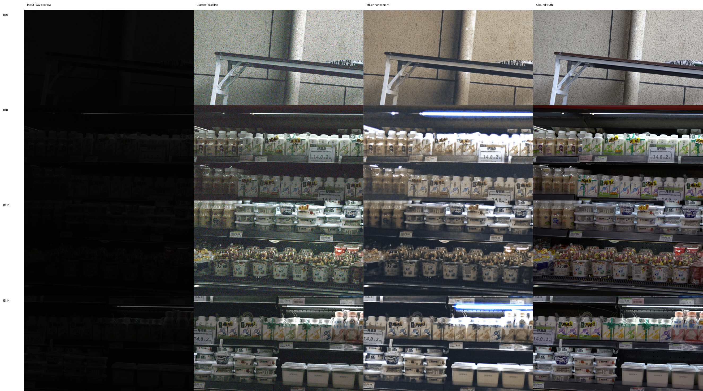
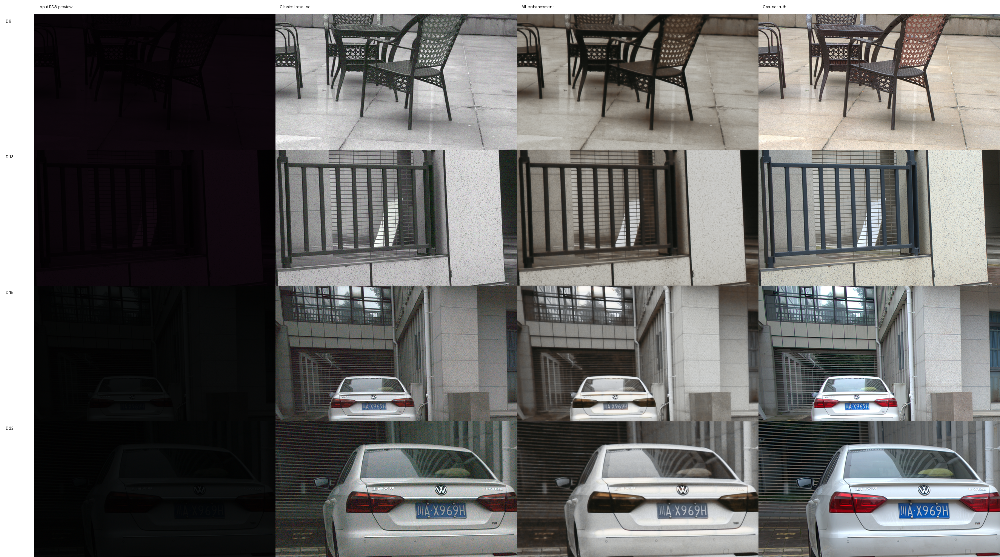
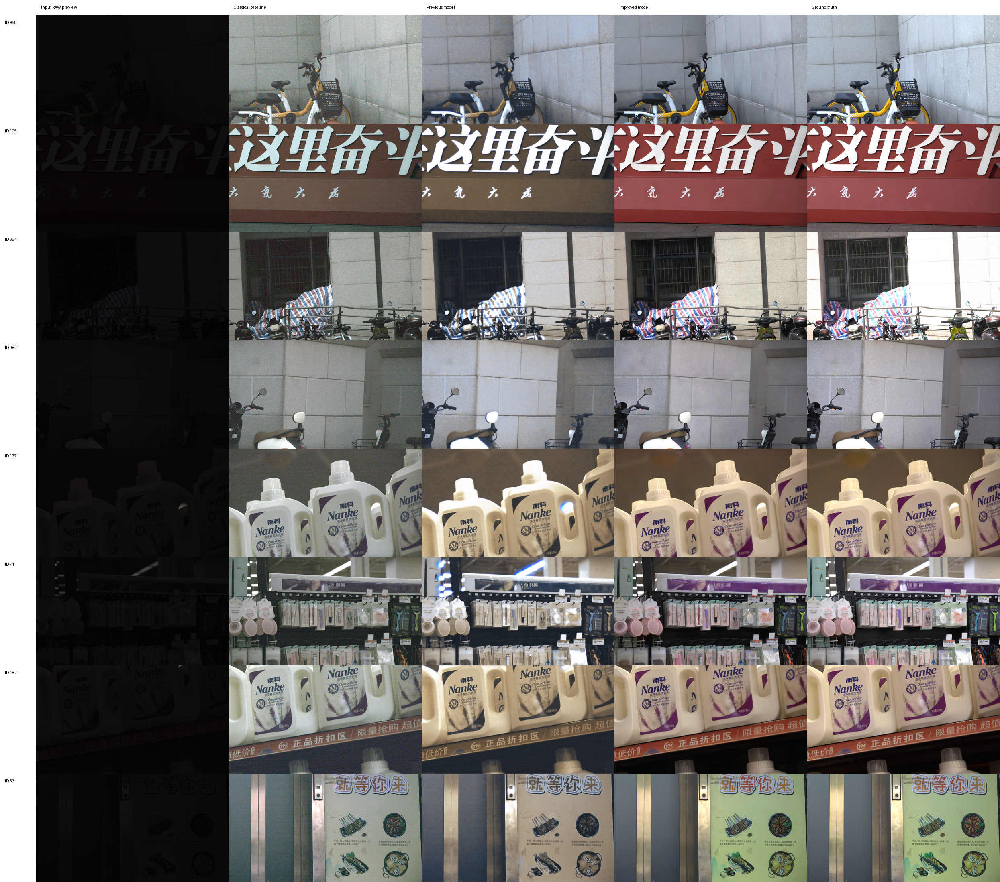

# SIED 极暗 RAW 图像增强实验报告

更新时间：2026-10-03

## 1. 实验目标与数据

本实验完成课程第一部分要求：数据集读取、算法/模型设计、图像增强、客观效果评价，以及增强前后的可视化比较。处理对象为 SIED 数据集中的 Canon `0.0001` 与 Sony `0.001` 两个极暗 RAW 子集。

两个子集各包含 1000 对 `RAW + GT`。全部 RAW 均通过逐文件审计：3840×2160、`uint16`、黑电平 512、白电平 16383，文件尺寸与配对错误均为 0。读取过程为黑电平扣除、白电平归一化和 RGGB 四通道打包；不通过强制缩放掩盖尺寸问题。

使用 SIED 官方仓库提交 `fb7af94ac831e91c647415bf1ca0b1a75931833a` 的测试划分，并从官方训练部分按固定种子 `20260930` 抽取 10% 验证集：

| 子集 | 训练 | 验证 | 官方测试 | 合计 |
|---|---:|---:|---:|---:|
| Canon | 832 | 92 | 76 | 1000 |
| Sony | 822 | 91 | 87 | 1000 |

训练、验证和测试清单在 RAW 与 GT 路径上均互斥。验证集用于选择权重，测试集只用于最终评价。

## 2. 算法设计

### 2.1 传统自动 ISP 基线

处理链为：黑电平校正 → RGGB 去马赛克 → 灰世界白平衡 → 高分位自动曝光 → Gamma 映射 → `[0,1]` 裁剪。逐图曝光和白平衡只读取该图 RAW 的统计量，不读取 GT。全局参数仅在验证集选择并冻结：

- Canon：`gamma=2.0, percentile=98, target=0.9`；
- Sony：`gamma=1.8, percentile=99, target=0.9`。

### 2.2 学习型增强模型

主模型是约 1789 万参数的 Residual U-Net。输入为半分辨率的四通道打包 RAW，末端输出 12 通道并通过 PixelShuffle 2×恢复为原始分辨率 RGB。训练使用 256×256 RAW patch（对应 512×512 GT patch）、batch size 4、AdamW、学习率 `1e-4`、FP16 和固定随机种子。

主损失为：

```text
L = L1 + 0.2 × (1 - SSIM) + 1.0 × L_chroma
```

`L_chroma` 是 YCbCr 两个色度分量上的逐像素 L1，用于减少偏灰和错色。模型采用 BatchNorm；推理时使用固定运行统计，避免 GroupNorm 随每个图块改变统计量。4K 整图按 256×256 RAW 图块、32 像素重叠推理，并用二维 Hann 窗羽化融合，以消除拼接线。

### 2.3 色彩保真升级与 SIED 官方模型

针对原模型将红色招牌、紫色商品标签还原为棕色或米色的问题，本项目先实现 HVI 色度/亮度解耦、全局亮度条件、软直方图、环形色相损失、颜色感知裁剪与场景自适应 3D LUT，并以受限参数微调避免小数据破坏已经学到的去噪能力。该路线改善了平均色差，但色相恢复仍不充分。

最终 Canon 改进方案调用 SIED ICCV 2025 作者发布的 `canon_0.0001.pt` EMA 权重，模型使用 AICM 和 Stage-2 潜特征扩散，按论文配置执行 20 步 DDIM 采样。作者原 `sample()` 会把 GT RGB 拼入输入并计算一个最终未被预测采用的 GT 特征；本项目适配器直接调用低照 RAW 特征分支与 RGB 解码器，推理时完全不读取 GT。GT 只在预测完成后载入并计算指标，从实现上排除答案泄漏。最终输出平均三次独立 DDIM 预测以降低扩散随机性；种子安排保证每张图的第一个样本与单次推理完全相同。

## 3. 训练与模型选择

计算环境为单张 RTX 4090 24GB、PyTorch 2.8.0 + CUDA 12.8。Canon 和 Sony 独立训练，训练过程保存环境、清单哈希、逐步日志和可恢复检查点。

| 实验 | 关键差异 | 验证结果/结论 |
|---|---|---|
| Canon E1 | GroupNorm，纯 L1 | 5000 步可学习，但颜色与图块一致性较弱 |
| Canon E2 原型 | GroupNorm，L1+SSIM | 最佳验证 PSNR 19.83 dB；整图出现偏灰和横向分块痕迹 |
| Canon 主模型 | BatchNorm，增加色度损失与 Hann 融合 | 第 3000 步最优：PSNR 20.80 dB、SSIM 0.7649 |
| Canon 大块消融 | 无归一化，512 patch | 1000/2000 步约 13.24 dB，未达放行线，提前停止 |
| Sony 主模型 | 与 Canon 主模型相同 | 第 2000 步最优：PSNR 21.58 dB、SSIM 0.7624 |
| Canon 颜色受限微调 | 冻结 BatchNorm；只训练输出头、AICM 或 3D LUT | 8 张门禁最佳 PSNR 20.99 dB、ΔE2000 9.75；色调有改善但仍明显偏灰 |
| Canon SIED 官方 EMA | 作者 Stage-2 权重；20 步 DDIM；三次预测平均；盲推理适配 | 8 张门禁 PSNR 24.74 dB、ΔE2000 5.75、色相误差 13.53°，作为最终改进方案 |

Canon 在 5000 步时验证指标明显回落，Sony 在 2000 步后也未继续改善。因此依据事先规定的验证集早停规则，最终分别采用第 3000 步与第 2000 步的 `best.pt`，没有为了凑足 50,000 步继续过拟合。

## 4. 官方测试集结果

以下指标均在原始 3840×2160 RGB 图像上计算。PSNR/SSIM 使用 `data_range=1.0`；LPIPS 使用 AlexNet v0.1，并将输入从 `[0,1]` 映射到 `[-1,1]`。PSNR、SSIM 越高越好，LPIPS 越低越好。

| 方法 | 子集 | 数量 | PSNR / dB ↑ | SSIM ↑ | LPIPS ↓ |
|---|---|---:|---:|---:|---:|
| 自动传统 ISP | Canon | 76 | 13.7400 | 0.1355 | 0.9164 |
| Residual U-Net 主模型 | Canon | 76 | 16.1234 | 0.6220 | **0.6380** |
| SIED 官方 EMA，三次采样平均 | Canon | 76 | **22.1700** | **0.7817** | — |
| 自动传统 ISP | Sony | 87 | 14.2986 | 0.1642 | 0.8655 |
| Residual U-Net 主模型 | Sony | 87 | **17.0517** | **0.6332** | **0.6964** |

相对自动传统 ISP：

- Canon：PSNR `+2.3834 dB`、SSIM `+0.4865`、LPIPS `-0.2784`；
- Sony：PSNR `+2.7531 dB`、SSIM `+0.4691`、LPIPS `-0.1691`。

SIED 三次采样平均相对 Canon 原 U-Net 再提升 `6.0466 dB` PSNR 和 `0.1597` SSIM；全测试集 ΔE2000 为 `7.9642`，亮度 MAE 为 `7.8672`，饱和度 MAE 为 `0.0665`，色相误差为 `24.76°`。相对单次 SIED，PSNR/SSIM、平均与 P95 色差、亮度、饱和度和色相七项汇总指标均有改善。SIED 本轮没有重复计算 LPIPS，因此表中留空，不用不同评价流程的数字凑表。

结果说明学习模型在结构保持和感知相似度上明显优于直接放大曝光的传统方法。传统方法会同步放大极暗 RAW 的噪声；原 U-Net 能显著去噪但容易把高饱和颜色变灰；SIED 显著改善了色相和颜色分布，同时仍有少数场景存在整体欠曝光。

## 5. 可视化与异常分析

原报告四列对比图依次为：输入 RAW 预览、自动传统 ISP、学习模型、GT。Canon 示例使用测试集 ID 6/8/10/14；Sony 示例使用 ID 6/13/15/22。可视化表明 Hann 羽化后没有旧版本的横向拼接线，学习模型的噪声显著少于传统方法；同时强灯带附近仍可能过曝，商品颜色有时低于 GT 饱和度。

颜色升级另使用 8 张 Canon 验证门禁图制作五列图：输入 RAW、传统 ISP、原 Residual U-Net、SIED 改进模型、GT。红色招牌和紫色洗衣液标签的色相已明显接近 GT；ID 958、664 仍存在整体欠曝光，这是当前最终模型保留的主要失败类型。

### Canon 对比



### Sony 对比



### Canon 色彩升级五列对比



逐图指标未被均值隐藏。Canon 最低 PSNR 样本为 ID 35（3.23 dB），Sony 为 ID 61（4.77 dB）；这些极端异常主要表现为整体曝光判断失败。后续可采用全局亮度条件、曝光分组采样、EMA 和更丰富的颜色分布损失继续改善。

## 6. 结果文件

- Canon 学习模型汇总与逐图指标：`reports/assets/enhancement/canon/summary.json`、`metrics.csv`；
- Sony 学习模型汇总与逐图指标：`reports/assets/enhancement/sony/summary.json`、`metrics.csv`；
- Canon/Sony 传统基线：`reports/assets/enhancement/canon_classical/`、`sony_classical/`；
- 四列可视化：`reports/assets/enhancement/canon/comparison.png`、`sony/comparison.png`；
- Canon 色彩门禁五列图与逐图色彩指标：`reports/assets/enhancement/canon_official/`；
- Canon SIED 三次采样平均的官方测试逐图与汇总指标：`reports/assets/enhancement/canon_official/test_metrics.csv`、`test_summary.json`；
- 精简推理权重及完整训练日志保存在本机 `checkpoints/` 与 `outputs/`，不提交到 Git；
- 可复现实验配置：`configs/enhancement/`；
- 官方训练/验证/测试清单：`manifests/enhancement/`。

本报告中的汇总值均可由对应逐图 CSV 重新计算；训练配置、数据清单和权重相互独立保存，满足课程演示与复现实验需要。
