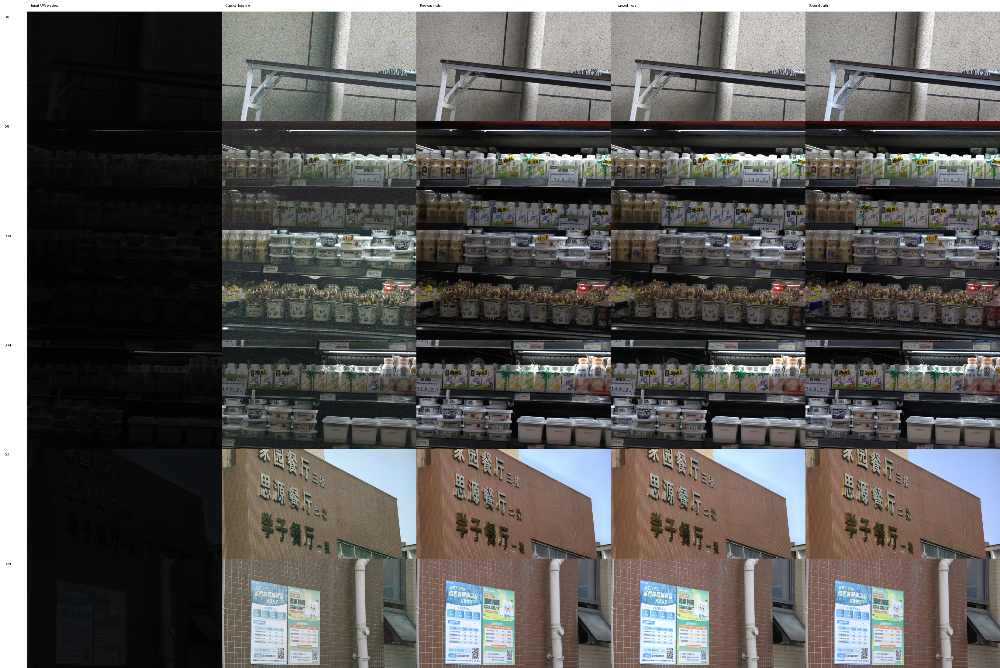

# Canon 极暗图像增强冲刺实验报告：Phase 1–5

更新日期：2026-10-24（Asia/Taipei）。范围：课程任务一，SIED Canon `0.0001`；本轮未继续训练 Sony，任务二几何校正和任务三压缩暂停。

**最终76张测试：平均PSNR 23.29599643dB、SSIM 0.78580246、LPIPS 0.38010382。25/30dB目标均未达到。** 相比历史光度v2，PSNR提高0.2980dB、平均色差降低4.21%，但SSIM下降0.000963、饱和度误差增加1.92%，不是全指标提升。五阶段完整92张验证最高26.63696698dB，对应Phase4，不能把这个有预训练暴露的内部验证数字当作测试成绩。本轮按固定全量门槛选择Phase4，仅最终验收一次，保留所有失败和负结果。

## 1. 数据、划分与结果应如何解读

Canon 共 1000 对低光 RAW 与正常曝光 JPG 参考。RAW 为 3840×2160、无文件头 `uint16`，每张 16,588,800 字节；黑电平 512、白电平 16383。处理按 `(RAW-512)/(16383-512)` 归一化、裁剪至 `[0,1]`，打包为 R、G（R 行）、B、G（B 行）四通道。逐文件尺寸与配对审计通过，Canon 1000 对合计检查字节为 18,669,533,292。

使用官方 SIED 仓库提交 `fb7af94ac831e91c647415bf1ca0b1a75931833a` 的划分：从课程 1000 对中映射出官方训练 924 对与官方测试 76 对，再从 924 对以种子 `20260930` 划出 92 张精修验证图。

| 用途 | 数量 | 清单 | SHA256 |
|---|---:|---|---|
| 精修训练 | 832 | `manifests/enhancement/canon_train.txt` | `b5068639ac967d4e1cdd34893c9c0ba33393b9f73eff9ef1f7b8746bef792a01` |
| 精修验证 | 92 | `manifests/enhancement/canon_val.txt` | `a17a96a26fa3dc8d1a63e3cdacd6c86b6ca17132cd8b6860a76a08595ff0968a` |
| 官方测试 | 76 | `manifests/enhancement/canon_test.txt` | `bbb3561f320e2c37dc850f625e0efbdd8ca6a5e2943d09f711fba8f4a745f8a8` |

划分依据见 [canon_official_split.json](../manifests/enhancement/canon_official_split.json)。训练器检查 RAW、GT 路径与 key 互斥，但需要同时说明两个局限：

1. **官方 SIED 基础权重已在官方训练部分预训练，包含这 92 张精修验证图。** 验证集只对我们新增分支的训练独立，对整个预训练流水线不是全新场景。因此 26.64 dB 是有预训练暴露的内部验证结果，不是 76 张测试成绩，也不是无偏的外部泛化估计。
2. **这 76 张官方测试图此前已用于传统 ISP、U-Net、SIED 与旧精修器的基线报告。** 本轮仅在设计与权重选择结束后验收一次，但不能宣传为项目历史上的首次揭盲、首次接触测试集或全新外部验证。后续若继续研究，应另外准备基础模型未训练过、项目未检查过的独立场景集。

## 2. 已实现方法与实现位置

### 2.1 传统自动 ISP

黑电平校正 → RGGB 去马赛克 → 灰世界白平衡 → 高分位自动曝光 → Gamma → 有界输出。Canon 验证集确定 `gamma=2.0`、`percentile=98`、`target=0.9`、白平衡指数 1.0；逐图曝光与白平衡只使用低光 RAW 统计量。

代码：`src/dip_course/enhancement/classical.py`、`src/dip_course/cli/run_classical.py`。该基线透明、易复现，但在极暗输入上会同时放大噪声。

### 2.2 Residual U-Net 课程基线

约 1789 万参数的 U-Net 接受半分辨率四通道 RAW，输出 12 通道后通过 PixelShuffle 2×恢复 4K RGB。采用 BatchNorm、256×256 RAW patch（对应 512×512 RGB）、batch size 4、AdamW、学习率 `1e-4`，以 `L1 + 0.2(1-SSIM) + 1.0 L_chroma` 训练。原生推理采用 256 RAW tile、32 重叠与 Hann 羽化。历史 Canon 最优权重来自第 3000 步。

代码：`enhancement/model.py`、`enhancement/tiling.py`、`cli/train_enhancement.py`、`cli/infer_enhancement.py`，配置 `configs/enhancement/canon.toml`。16.12 dB 是这一早期基线的历史测试值，不能代替最终改进方法的成绩。

### 2.3 SIED 官方 EMA 与全场景光度精修

基础恢复使用 ICCV 2025 SIED 作者模型：AICM、RAW/RGB 编解码器与 Stage-2 潜特征扩散。项目适配器直接执行低光 RAW 分支，不把 GT 作为推理输入；20 步 DDIM，以三次独立采样平均减少随机误差。第 `i` 张图第 `j` 个样本的种子为 `3407 + i + j×1000003`。

光度精修器 `ExposureColorRefiner` 以整张图的低分辨率上下文预测受限的曝光、Gamma、白平衡、3×3 颜色矩阵和低频局部照度。它在近似线性光域校正，再返回 sRGB，初始映射为恒等映射。已有 v1、v2 两版：v2 从 v1 初始化，使用盲预测缩略图、BF16、batch size 8、学习率 `2e-5`、1500 步训练。旧 v2 历史测试 PSNR 为 22.9979955215 dB。

代码：`cli/infer_official_sied.py`、`cli/train_sied_refiner.py`、`enhancement/refiner.py`。旧 v2 训练参数的直接证据为 [canon_sied_refiner_v2.log](assets/enhancement/refiner_v2/canon_sied_refiner_v2.log) 开头的环境记录。

### 2.4 RAW-guided NAF 残差精修

在光度校正后的 SIED RGB 上增加 NAFNet 风格 U 形结构分支。四通道 RAW 经全场景均值估计的增益放大至可用数值范围，再插值与 RGB 对齐，形成七通道输入。采用 LayerNorm2d、SimpleGate、简化通道注意力、编码块 `2/2/4`、中间 6 块、解码块 `2/2/2`、宽度 48。输出为 `0.35×tanh(residual)`，最后与光度校正结果相加并裁剪。

RAW 目标均值为 0.1，增益上限 4096。输出头零初始化；结构分支的有界残差和光度分支的受限参数减少无依据的大幅改色。模型借鉴 SIED、NAFNet、DNF 的思想，但不等于完整复现 DNF，也不构成自行训练一个通用视觉大模型。

代码：`enhancement/refiner.py`、`enhancement/dataset.py`、`cli/train_sied_restorer.py`、`cli/train_sied_restorer_native.py`、`cli/train_sied_restorer_context.py`。

## 3. Phase 1–5 训练安排与准确结果

### 3.1 阶段安排

| 阶段 | 训练输入及主要设置 | 训练内选择 | 完整验证设置 |
|---|---|---|---|
| Phase 1 | 单次 SIED 盲预测的长边 768 缩略图；从 v2 光度权重初始化；2 万步；LR `2e-4`；balanced loss | 768 缩略图验证；再对 best/last 两个候选做 92 张原生比较 | 新生成三次 SIED 平均；768 tile/96 overlap |
| Phase 2 | 每步在线生成单次 SIED 原生预测后裁出 512 RGB；2500 步；LR `5e-5`；冻结光度参数 | 固定前 48 张原生、单次 SIED 验证 | 三次 SIED 平均；92 张；768/96 |
| Phase 3 | 从 Phase 2 微调；2000 步；LR `2e-5`；MSE 主导 psnr loss | 48 张原生验证 | 三次 SIED 平均；92 张；768/96 |
| Phase 4 | 924 张三次 SIED 原生盲预测缓存；512 crop；2 万步；LR `2e-5`；全场景 RAW 均值增益 | 每 500 步使用 768 缩略图验证选权重 | 新生成三次 SIED 平均；92 张；768/96 |
| Phase 5 | 先整图光度校正、float16 缓存，再 512 crop；光度冻结；上限 1 万步，实际 3000 步早停 | 每 500 步在固定 12 张原生验证；原生 PSNR 与颜色/SSIM 门槛 | 原生缓存上 92 张；512/64 |

所有新 NAF 阶段使用 AdamW、余弦学习率、EMA `0.999`、batch size 1、FP16。Phase 1–4 种子 `20261021`，Phase 5 种子 `20261023`。Phase 1–3 的训练内评价、缩略图评价与完整原生评价属于不同协议，不能互相替代。

本轮恢复环境为 Python 3.12.3、PyTorch `2.8.0+cu128`、RTX 4080 SUPER vGPU（约 32 GB）、150 GB 数据盘；前期 Phase 1–3 使用 RTX 4090。硬件与 FP16 算法可能造成小数末位差异，固定随机种子不等于跨硬件逐位一致。

### 3.2 完整 92 张原生验证结果

| 阶段 | PSNR / dB ↑ | SSIM ↑ | 平均 ΔE2000 ↓ | 结论 |
|---|---:|---:|---:|---|
| Phase 1 selected | 26.1346614106 | 0.8534935739 | 4.5593802607 | 明确低于后续 Phase 2 |
| Phase 2 | 26.6369239495 | 0.8562718630 | 4.4963298935 | 固定完整验证参考 |
| Phase 3 | 26.6369232830 | 0.8562718591 | 4.4963284024 | 与 Phase 2 数值等价，无实质收益 |
| Phase 4 | **26.6369669807** | **0.8562718740** | **4.4963135387** | 按既定 PSNR 规则入选；不能把极小差异描述成性能突破 |
| Phase 5 best（step 0） | 26.5858109822 | 0.8552129314 | 4.5068981044 | 未超过 Phase 4；新训练权重未被选择 |

Phase1–3汇总摘要随[本轮轻量证据目录](assets/enhancement/sprint_20261024/runs/)归档入Git，其PSNR还由[Phase5 initial_selection.json](assets/enhancement/sprint_20261024/runs/canon_raw_guided_naf_phase5_context/initial_selection.json)交叉记录。**前3阶段的旧逐图CSV未随云机迁移保存，当前不能从旧逐图数据独立重算其均值**；可使用已保存权重、相同清单和种子重新运行验证来核对，不能伪造缺失记录。Phase4/5本轮完整逐图数据已保存。

Phase4直接证据：[完整验证](assets/enhancement/sprint_20261024/runs/canon_raw_guided_naf_phase4_val_native/summary.json)、[逐图CSV](assets/enhancement/sprint_20261024/runs/canon_raw_guided_naf_phase4_val_native/metrics.csv)、[训练摘要](assets/enhancement/sprint_20261024/runs/canon_raw_guided_naf_phase4_cached_native/summary.json)。Phase5直接证据：[完整验证](assets/enhancement/sprint_20261024/runs/canon_raw_guided_naf_phase5_val_native/summary.json)、[逐图JSON](assets/enhancement/sprint_20261024/runs/canon_raw_guided_naf_phase5_val_native/metrics.json)、[3000步训练摘要](assets/enhancement/sprint_20261024/runs/canon_raw_guided_naf_phase5_context/summary.json)。

Phase 1 缩略图最高 PSNR 曾达到 27.6066436975 dB，但选中权重的完整原生值为 26.1346614106 dB；Phase 4 缩略图最佳为 27.5577593783 dB，而完整原生为 26.6369669807 dB。缩略图降低了高频误差，数字更高不等于原生质量更高。

### 3.3 Phase 4 与 Phase 5 全量颜色指标

| 指标 | Phase 4，768/96 | Phase 5 best，512/64 |
|---|---:|---:|
| ΔE2000 平均 ↓ | 4.4963135387 | 4.5068981044 |
| ΔE2000 P95 平均 ↓ | 7.8317451036 | 7.8714533656 |
| 亮度 MAE ↓ | 4.4551119623 | 4.4658540112 |
| 饱和度 MAE ↓ | 0.0337416662 | 0.0338260982 |
| 色相误差 / ° ↓ | 11.3469061461 | 11.3612336710 |
| LPIPS ↓ | 未计算 | 未计算 |

Phase 5 的全量结果评价的是保留的初始化权重，不是第 3000 步权重；而且 tile 与缓存精度相对 Phase 4 已改变，二者差值不能单独归因于“训练造成退化”。

## 4. 负结果与未达到 30 dB 的原因

Phase 4 跑满 2 万步，但所选 `best.pt` 的 `global_step=1`。Phase 3 的最佳权重也基本停留在起点。新增迭代没有持续改善预设评价目标，因此保留早期权重；这是有效的负结果，不应把“完成更多训练”写成“模型变得更好”。

Phase 5 修复了两个已确认的方法问题：局部 patch 重算光度上下文与整图推理不一致；缩略图选权重与原生评价目标不一致。修复后训练健康，但固定 12 张验证 PSNR 始终没有比初始化高出预设的 0.01 dB。达到最少 2500 步后，第六次无改进验证在 3000 步触发早停，`best.pt` 仍为 step 0。

| Phase 5 快速原生验证 | PSNR / dB ↑ | SSIM ↑ | 平均 ΔE2000 ↓ |
|---|---:|---:|---:|
| 初始 step 0 | 26.4478484056 | 0.8548689683 | 4.7591377890 |
| step 500 | 26.4072471236 | 0.8551529795 | 4.7452093893 |
| step 1500 | 26.3630675213 | 0.8556903402 | 4.7220364515 |
| step 2500 | 26.3765272197 | 0.8557370255 | 4.6967469900 |
| step 3000 | 26.3761101411 | 0.8559027811 | 4.6866802931 |

记录显示颜色与结构指标可以改善而 PSNR 回落，存在真实的多目标权衡。可合理提出、但本轮尚未做完因果消融的原因包括：基础 SIED 已限定可恢复的信息；小样本训练场景与历史测试场景差异；辅助颜色/结构损失与逐像素 MSE 目标不完全一致；全局聚合的尺度差异；PNG 与 float16 缓存的微小精度误差。

从 26.637 dB 提高到 30 dB，还需要约 3.36 dB，等价于把相同协议下的几何平均 MSE 降到约 46%。这不是调整一个 Gamma 或继续原学习率训练就能保证达到的幅度。基于现有实验，不能承诺通过延长训练获得 30 dB。

## 5. 历史 76 张测试结果：只作已公开基线

下表均为此前已取得并归档的结果；**不是本轮 NAF 模型的新测试成绩**。本表按每份摘要的模型版本、样本数与评价协议单独列出，不将旧报告中不同轮次的数字强行等同，也不把未经查证的差异归因于硬件。

| 历史方法 | PSNR / dB ↑ | SSIM ↑ | LPIPS ↓ | 直接摘要 |
|---|---:|---:|---:|---|
| 自动传统 ISP | 13.7399911727 | 0.1355343851 | 0.9163697534 | [canon_classical](assets/enhancement/canon_classical/summary.json) |
| Residual U-Net | 16.1233923985 | 0.6220375366 | 0.6379940200 | [canon](assets/enhancement/canon/summary.json) |
| SIED 官方 EMA，三次平均 | 22.1699536849 | 0.7817027173 | 未计算 | [canon_official](assets/enhancement/canon_official/test_summary.json) |
| SIED + 光度精修 v1 | 22.9059839871 | 0.7861172710 | 未计算 | [canon_official_refiner](assets/enhancement/canon_official_refiner/test_summary.json) |
| SIED + 光度精修 v2 | 22.9979955215 | 0.7867649672 | 未计算 | [final_4090](assets/enhancement/final_4090/summary.json) |

旧 `enhancement_final_report.md` 表中的约 22.9060 对应 1000 步 v1；活动记录中约 22.9980 对应 1500 步 v2。这里分别引用各版明确的测试摘要，而非从旧报告表格挑选较高值后改名。

v2 历史颜色指标：平均 ΔE2000 7.2288391807、P95 平均 13.0472788393、亮度 MAE 6.8176499072、饱和度 MAE 0.0670080540、色相误差 24.7777495717°。另一个 `base_evaluation` 汇总是在保存的 8-bit 基础图上重新评价，PSNR 为 22.1681607783 dB；它与预测浮点张量上的 22.1699536849 dB 协议有精度差异，不能把两者混成同一条记录。

旧 U-Net 可视化：[历史对比图](assets/enhancement/canon/comparison.png)；旧 v2 可视化：[历史精修对比图](assets/enhancement/final_4090/comparison.png)。本轮新对比图待验收完成后填入文末。

## 6. 指标、放行规则与防止错配

正式 PSNR 取每张原生 3840×2160 RGB 的 `-10 log10(MSE)` 后求 76/92 张算术平均。它不同于把所有图像像素 MSE 合并后再取对数的 `global_psnr`。PSNR/SSIM 的输入为 `[0,1]` sRGB；SSIM 正式实现见 `metrics.py` 的 scikit-image 调用，训练时的可微 SSIM 只作为训练/快速评价工具。LPIPS 使用 AlexNet v0.1，输入映射到 `[-1,1]`。

ΔE2000、亮度 MAE、HSV 饱和度/色相误差在长边不超过 960 的副本上计算，以控制成本；不能把这些值描述为逐像素 4K 色差。色相误差使用环形距离，并对 GT 饱和度 ≥0.1、亮度 ≥0.05 的像素计分。

最终从 Phase 1–5 的完整 92 张原生结果选择：

1. 候选须 `count=92`、数值有限、权重文件存在；若摘要声明 SHA256，必须匹配权重实物。Phase 5 训练完成摘要、验证摘要、权重 SHA256 必须一致。
2. 固定参考 Phase 2：SSIM 最多下降 0.002；参考中已有的平均/P95 ΔE2000、亮度 MAE、饱和度 MAE、色相误差各最多增加 2%；缺少参考指标不能绕过门槛。
3. 在合格候选中选择平均 PSNR 最高者，Phase 2 保留为兜底。本轮审查为 Phase 1 未通过，Phase 2–5 通过，最终选择 Phase 4。允许 2% 回摆不等于所有指标均提升。

`final/selection.json` 不可覆盖，绑定精修和官方权重 SHA256、冻结清单 SHA256、seed、步数、集成数量、精度、tile/overlap。推理使用独立复制并核验的 `final/best.pt`；开始前写入启动标记，完成后验证 76 张逐图 key、摘要和参数，写入带摘要/CSV 哈希的 `verification.json`。已存在但绑定不一致的结果直接失败保留，不能替换权重却沿用旧成绩，也不能为挑分数自动重复本轮验收。Linux `flock` 防并发，`HOLD_FINALIZE` 在审核前保持阻断。

## 7. 版本、权重取得与哈希

官方代码：[JianghaiSCU/SIED](https://github.com/JianghaiSCU/SIED)，固定提交 `fb7af94ac831e91c647415bf1ca0b1a75931833a`。数据与作者基础权重从其 README 发布的官方网盘取得；项目的 `cloud/download_official_sied_assets.py` 解析公开链接并支持断点下载。不要把第三方网盘镜像或其他相机的权重冒充本实验权重。

本项目训练的精修器不由SIED作者提供。轻量v2光度初始化权重189KiB已随仓库保存在`reports/assets/enhancement/refiner_v2/best.pt`，克隆后核对下表哈希；新NAF精修器约35MiB需从本次本地/私有备份取得，或依步骤完整重训。仅克隆代码不包含官方大权重、原始数据和4K输出。旧U-Net与v1权重的历史登记见[DATA_AND_WEIGHTS.md](../DATA_AND_WEIGHTS.md)。

下列值为 2026-10-24 对本机现存文件实算 SHA256：

| 文件 | SHA256 |
|---|---|
| `checkpoints/sied30_resume_snapshot/phase1/selected.pt` | `53dd45b372e08ac10da40dd8f400cb1f06a562e42d66e6366a1cbc414a2f631c` |
| `checkpoints/sied30_resume_snapshot/phase2/best.pt` | `91b5059e67b0c5f8f9521e231566c4a59c59b33aff0bf7229b24a1097e0ea289` |
| `checkpoints/sied30_resume_snapshot/phase3/best.pt` | `f6b0175724e7e53ad1cf2c5573c30c61cf0fef9b3499c464f0af106693ee028c` |
| `checkpoints/sied30_resume_snapshot/phase4/best.pt` | `337acc11705e8ae1f170d22263161b210a0ed0d4272a647db4e82ccbb611f2d8` |
| `checkpoints/sied30_resume_snapshot/phase5/best.pt` | `864a15c6a75c5433399669ca1611745933bbaa988abc8190077557784d4f7fb5` |
| `reports/assets/enhancement/refiner_v2/best.pt` | `0428cdb082979ed960cfd5925a78ae558a635dfd8eaf0f783023272f65b27afa` |

历史完整作者检查点在v2日志中的SHA256为`81b0215ef4729161fa7405c83063c29b387851de99d15017652067b92e888778`；旧文档中的精简EMA文件为`327813671119063b970ae1f26430e88a3d682a8e20c455b18aea102b0687c4e5`。不同文件不能混用哈希。本轮实际官方文件2610348582字节，SHA256为`40014f1f71dfdcd9a8969074097f675a54d2598aec26b183c0874bfcd5c26238`，已由不可变`final/selection.json`绑定。不在未做张量级比较时宣称它与历史其他封装逐位等价。

本轮增强代码封板commit：`75b0c84ba21a940638ad9b8b49255260df8aa3be`。最终指标、图像和本文的交付记录在后续文档提交保存，不改变该代码快照；几何/压缩未完成修改不属于此提交。固定权重推理可复现已选模型；从头训练涉及CUDA算子、依赖版本和随机裁剪序列，不能仅凭相同种子承诺逐位一致。

## 8. 精确复现步骤

以下供将来在**全新复现目录**操作，不是要求对当前运行目录重复执行。采用 Linux 单卡 CUDA；本机 CPU/MPS 可运行基础测试、ISP、U-Net 推理，但当前 SIED/NAF FP16 完整链要求 CUDA，勿将本机“能导入包”当作完整复现。

### 8.1 新环境、代码与数据

```bash
export ROOT=/root/autodl-tmp/sied30_reproduction
git clone https://github.com/xuntonghan/digital-image-proocess-work.git "$ROOT/project"
git -C "$ROOT/project" checkout --detach 75b0c84ba21a940638ad9b8b49255260df8aa3be
python3.12 -m venv "$ROOT/.venv"
source "$ROOT/.venv/bin/activate"
python -m pip install --upgrade pip
python -m pip install torch==2.8.0 torchvision==0.23.0 --index-url https://download.pytorch.org/whl/cu128
cd "$ROOT/project"
python -m pip install -e '.[sied,train,dev]' requests
export PYTHON="$ROOT/.venv/bin/python"
mkdir -p "$ROOT/third_party"
git clone https://github.com/JianghaiSCU/SIED.git "$ROOT/third_party/SIED-official"
git -C "$ROOT/third_party/SIED-official" checkout --detach fb7af94ac831e91c647415bf1ca0b1a75931833a
```

准备数据和官方权重，可选择把已有归档复制到 `ROOT/data/SIED_dataset/{0.0001,gt}`、`ROOT/checkpoints/official/canon_0.0001.pt`，或在新目录运行：

```bash
bash cloud/prepare_sied_canon_assets.sh "$ROOT"
python -m dip_course.cli.audit_dataset \
  --data-root "$ROOT/data/SIED_dataset" \
  --manifest manifests/source/canon_all.txt \
  --output-json "$ROOT/runs/canon_audit.json"
```

准备脚本只用于全新`ROOT`，须使用本轮封板版本的拒绝覆盖实现，并保留下载压缩包。已有数据只审计复用，不重跑准备脚本；旧版先删目录再解压，不能用于唯一资料。审计必须`valid=true`、1000对、0错误。Phase1使用仓库自带189KiB v2光度权重`reports/assets/enhancement/refiner_v2/best.pt`，先核对SHA256为`0428...afa`；它不是官方SIED大权重。

### 8.2 不重新验收测试集的演示

先在 92 张验证集上运行，避免重复测试驱动调参。原生官方 SIED 与所选 NAF 的命令分别为：

```bash
python -m dip_course.cli.infer_official_sied \
  --official-repo "$ROOT/third_party/SIED-official" \
  --checkpoint "$ROOT/checkpoints/official/canon_0.0001.pt" \
  --data-root "$ROOT/data/SIED_dataset" \
  --manifest manifests/enhancement/canon_val.txt \
  --output-dir "$ROOT/outputs/sied_base_val" \
  --device cuda --precision fp16 --sampling-steps 20 --ensemble-size 3 --seed 3407

python -m dip_course.cli.infer_official_sied \
  --official-repo "$ROOT/third_party/SIED-official" \
  --checkpoint "$ROOT/checkpoints/official/canon_0.0001.pt" \
  --refiner-checkpoint checkpoints/sied30_resume_snapshot/phase4/best.pt \
  --data-root "$ROOT/data/SIED_dataset" \
  --manifest manifests/enhancement/canon_val.txt \
  --output-dir "$ROOT/outputs/naf_phase4_val" --save-base-dir "$ROOT/outputs/naf_phase4_base" \
  --device cuda --precision fp16 --sampling-steps 20 --ensemble-size 3 --seed 3407 \
  --refiner-tile-size 768 --refiner-overlap 96
```

第二条命令要求先把 Phase 4 归档权重复制到项目中对应路径。复现旧 v2 光度模型时，将该命令的 `--refiner-checkpoint` 换成 `reports/assets/enhancement/refiner_v2/best.pt`；该模型类型由权重元数据识别。仅演示前若干张可加 `--limit 4`，其结果必须标注样本数，不能冒充全量均值。保存图像评价与浮点预测评价有量化差异，重新算指标时应明确选用哪一份。

传统 ISP、U-Net 演示与传统训练配置复现：

```bash
python -m dip_course.cli.run_classical \
  --data-root "$ROOT/data/SIED_dataset" --manifest manifests/enhancement/canon_val.txt \
  --output-dir "$ROOT/outputs/isp_val" --auto --gamma 2.0 --auto-percentile 98 --auto-target 0.9
python -m dip_course.cli.train_enhancement \
  --config configs/enhancement/canon.toml --data-root "$ROOT/data/SIED_dataset" \
  --train-manifest manifests/enhancement/canon_train.txt --val-manifest manifests/enhancement/canon_val.txt \
  --output-dir "$ROOT/runs/unet_reproduction" --max-steps 5000 --device cuda --require-cuda
python -m dip_course.cli.infer_enhancement \
  --checkpoint "$ROOT/runs/unet_reproduction/best.pt" --data-root "$ROOT/data/SIED_dataset" \
  --manifest manifests/enhancement/canon_val.txt --output-dir "$ROOT/outputs/unet_val" \
  --device cuda --tile-size 256 --overlap 32
```

这段 U-Net 命令复现课程基线训练方法；它不是声明新跑的 `best.pt` 必然与历史第 3000 步权重逐位相同。准确复现历史推理应使用 [权重说明](../DATA_AND_WEIGHTS.md) 中已登记的推理权重。

### 8.3 完整重训 Phase 1–5

```bash
bash cloud/run_sied30_phase1.sh "$ROOT"
bash cloud/run_sied30_phase1_select.sh "$ROOT"
bash cloud/run_sied30_phase2.sh "$ROOT"
bash cloud/run_sied30_phase3_psnr.sh "$ROOT"
bash cloud/run_sied30_phase4_cached_native.sh "$ROOT"
bash cloud/run_sied30_phase5_context.sh "$ROOT"
```

这些脚本只处理训练/验证。Phase 4 缓存约 924 张原生三次盲预测 PNG；Phase 5 另建立约 42.83 GiB 的整图 float16 校正缓存。磁盘预算还须包含约 18.7 GB 已选数据、约 2.61 GB 完整官方权重、保留的源压缩包、PNG 缓存、软件环境、各步检查点和最终 4K 图像。应根据压缩包实际大小先计算峰值并留余量；不能假定 150 GB 必然足够，新建完整重训环境宜优先考虑 200 GB 或更大。Phase 4 的 `--initial-checkpoint` 是权重热启动，不恢复旧优化器；Phase 5 的 `--resume` 恢复本阶段优化器、EMA、调度器、scaler，但随机裁剪序列不承诺完全续接。

Phase 5 的复现设置为 `crop=512, tile=512, overlap=64, LR=2e-5, EMA=0.999, val_interval=500, val_limit=12, min_steps=2500, max_steps=10000, patience=6`。完整参数保存在各阶段 `run_environment.json`。训练/验证截图、缓存进度和迭代次数都不能代替完整评价结果。

### 8.4 评价与可视化、代码检查

```bash
python -m dip_course.cli.visualize_comparison \
  --data-root "$ROOT/data/SIED_dataset" --manifest manifests/enhancement/canon_val.txt \
  --reference-prediction-dir "$ROOT/outputs/naf_phase4_base" \
  --prediction-dir "$ROOT/outputs/naf_phase4_val/images" \
  --output "$ROOT/outputs/naf_phase4_val/comparison.png" --count 6 --auto --panel-width 640
python -m pytest tests/test_model.py tests/test_dataset.py tests/test_infer_official_sied.py \
  tests/test_train_sied_restorer_native.py tests/test_train_sied_restorer_context.py tests/test_sied_finalization.py
ruff check src tests
```

在数据、权重与五阶段验证齐备之后，最终验收入口为 `bash cloud/run_sied30_finalize.sh "$ROOT"`。它会检查 `HOLD_FINALIZE`，未审阅时应保持阻断；已有本轮验收记录则只核验复用，错配或中断不自动重测。日常课堂演示使用已保存结果或验证集，不需要反复执行冻结验收。

## 9. 后续值得做的实验

1. **先建立独立验证场景。** 使用官方基础模型未预训练过的新场景，记录 RAW、曝光和参考 RGB；否则内部验证的提升无法消除基础模型预训练暴露带来的乐观偏差。
2. **区分 PSNR、颜色和感知三个目标。** Phase 5 已证明颜色与 SSIM 可以改善而 PSNR 下滑。可保留两个 Pareto 候选：像素保真版与颜色/结构版，使用固定验证集门槛比较，不能靠测试图选择偏好的权重。
3. **只做有对照的小实验。** 在相同浮点基础缓存、同一原生 tile 上比较纯 MSE/较小辅助权重、冻结/解冻分支，先消除缓存量化与尺度混杂，再判断训练机制的真实效果。
4. **真正实现并消融 TLC。** 将 NAF 的全局聚合转换为与训练感受范围匹配的局部聚合；本轮统一 512 tile 只是缩小差异，不能写成已完整实现 TLC。
5. **训练集上的黑电平/噪声建模。** 极暗 RAW 均值很小，细微偏置可引起色差。可用受限全局偏置与 RAW 噪声模型增强，但不能用测试 GT 逐图调曝光或拟合颜色矩阵。
6. **确有额外数据与预算时再改基础模型。** 比较 RAW 域去噪与颜色恢复的特征级交互、SIED 解码器受限微调或新型单步恢复；新架构与不同数据集论文中的 30–40 dB 不能直接转移到 Canon `0.0001` 协议。单纯继续当前 Phase 4/5 训练已无证据支持高收益。

主要一手依据：[SIED，ICCV 2025](https://openaccess.thecvf.com/content/ICCV2025/html/Jiang_Learning_to_See_in_the_Extremely_Dark_ICCV_2025_paper.html)、[NAFNet 作者代码，ECCV 2022](https://github.com/megvii-research/NAFNet)、[DNF，CVPR 2023](https://openaccess.thecvf.com/content/CVPR2023/html/Jin_DNF_Decouple_and_Feedback_Network_for_Seeing_in_the_Dark_CVPR_2023_paper.html)、[TLC 作者代码，ECCV 2022](https://github.com/megvii-research/TLC)。2026 延伸阅读：[低光 RAW 黑电平色偏，ICCP 2026](https://arxiv.org/abs/2607.11090)；[MeanFlow 极暗 RAW 恢复预印本](https://arxiv.org/html/2608.01720v1)，其目标域、相机与 ISP 协议需逐项核对，不能直接拼入本表。

## 10. 本轮76张最终验收与交付记录

本轮选择Phase4；其验证超出Phase2的幅度不具实质意义，但按既定规则入选。推理固定为FP16、seed3407、20 DDIM步、3次独立平均、tile768、overlap96。原生76张的[摘要](assets/enhancement/sprint_20261024/final/frozen_test/summary.json)、[逐图CSV](assets/enhancement/sprint_20261024/final/frozen_test/metrics.csv)、[不可变选择](assets/enhancement/sprint_20261024/final/selection.json)和[校验收据](assets/enhancement/sprint_20261024/final/frozen_test/verification.json)均已保存。

| 项目 | 本轮结果 |
|---|---|
| 本轮模型 | Phase 4 RAW-guided NAF，所选权重 SHA256 `337acc11705e8ae1f170d22263161b210a0ed0d4272a647db4e82ccbb611f2d8` |
| 验收启动 | 2026-10-24 01:07:44，Asia/Taipei；后台会话`enhancement_finalize`，约01:26前完成并封存 |
| 官方基础文件 SHA256 | `40014f1f71dfdcd9a8969074097f675a54d2598aec26b183c0874bfcd5c26238` |
| 验收清单 | 76 张，SHA256 `bbb3561f320e2c37dc850f625e0efbdd8ca6a5e2943d09f711fba8f4a745f8a8` |
| 平均 PSNR / dB ↑ | 23.2959964300 |
| 平均 SSIM ↑ | 0.7858024608 |
| 平均 LPIPS ↓ | 0.3801038223 |
| ΔE2000平均 / P95平均 ↓ | 6.9248127125 / 12.6606551534 |
| 亮度MAE / 饱和度MAE / 色相误差 ↓ | 6.3237917408 / 0.0682967833 / 24.6087423743° |
| 原生推理平均耗时 | 2.868634049秒/张，4080 SUPER vGPU，计时包含3次SIED平均与精修，不包含完整评价/落盘开销 |
| 不可变选择、验证收据 | 本机`outputs/sied30_resume_snapshot/final/selection.json`与`final/frozen_test/verification.json` |
| 新增强前后对比图 | 本机`outputs/sied30_resume_snapshot/final/comparison.png`及下方Git资产 |
| 最终模型/日志/逐图指标备份 | `checkpoints/sied30_resume_snapshot/`及`outputs/sied30_resume_snapshot/`；官方与精修权重SHA256匹配，全部最终输出的rsync checksum dry-run无差异 |
| 云机关闭 | 2026-10-24约01:32，确认GPU无作业及异机备份校验后执行平台等效关机；两次复查SSH均返回连接关闭。未清空Trash，未销毁实例或删除数据盘；未独立查看控制台账单，不将SSH离线解释成存储费用清零 |

相对历史v2：PSNR+0.298001dB，SSIM-0.000962506；ΔE平均-4.21%、P95平均-2.96%、亮度MAE-7.24%、色相误差-0.68%，饱和度MAE+1.92%。这些是历史版本对照，不能据此声称基础文件逐位相同或所有指标提升。历史v2没有LPIPS结果，不能补造其感知改善幅度。

另将同一次推理保存的基础SIED与NAF结果，使用同一76张GT在本机只复算PSNR：8-bit PNG的基础22.16815663dB、精修23.29401601dB，差1.12585938dB，见[独立复算记录](assets/enhancement/sprint_20261024/final/paired_png_psnr.json)。该步骤不再执行神经模型，也不用于选权重。PNG量化与浮点正式摘要略有差异，不能混写。



图从左至右：输入RAW预览、传统ISP、同次未精修SIED、Phase4精修、GT。图中的“Previous model”特指基础SIED，不是历史光度v2。使用清单前六张，不挑选最有利样例。目视可见曝光/色调有小改善、纹理主要沿用SIED，未看到明显拼接线；并不支持“细节重建突破”或所有场景接近GT的结论。

测试摘要SHA256：`4dbc60944e359e7419c66d54eebf0015c5aa75ccfebf2f1acf0c83b7855a23a6`；逐图CSV：`97f8b2cf3acb1901c22dfa38b2f2a5e418595abb682f826c5aa80a56769cc82a`。官方2.61GB文件及35MiB最终精修器已完整备份并核对SHA；76张基础PNG、76张精修PNG、76张GT、对比图、日志及实际官方源码快照也已保存。GT仅保留为评价/展示参考，不转作训练数据。

代码封板的干净导出独立通过139项测试，不依赖未提交的几何/压缩代码；准备数据的4项防覆盖测试包含在其中。完整实际环境见[environment.json](assets/enhancement/sprint_20261024/final/environment.json)。本轮结束后不再为了25/30dB继续无限付费训练；下一轮应在独立数据与明确预算下重新制定方案。

已完成Canon五阶段训练、完整验证与76张最终验收；Sony及另外两项保持暂停，没有把旧结果包装成本轮成果。
