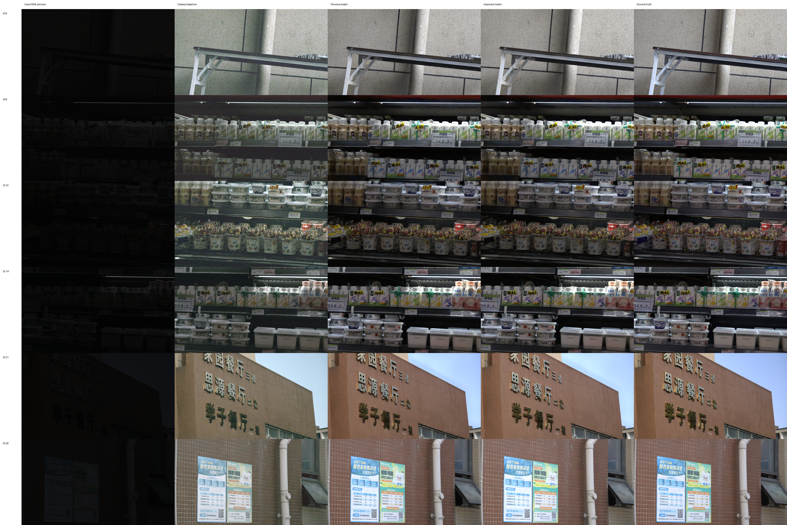
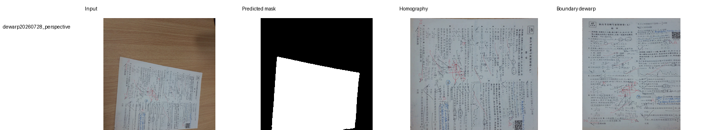
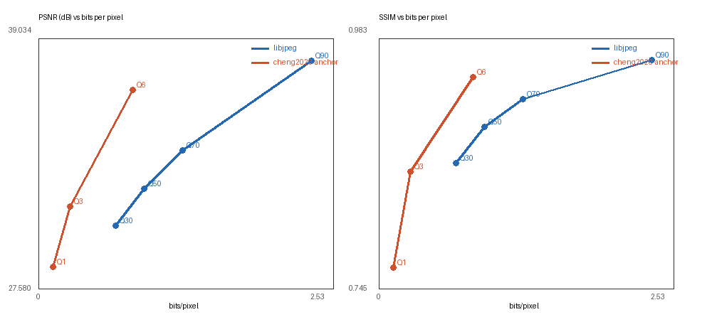
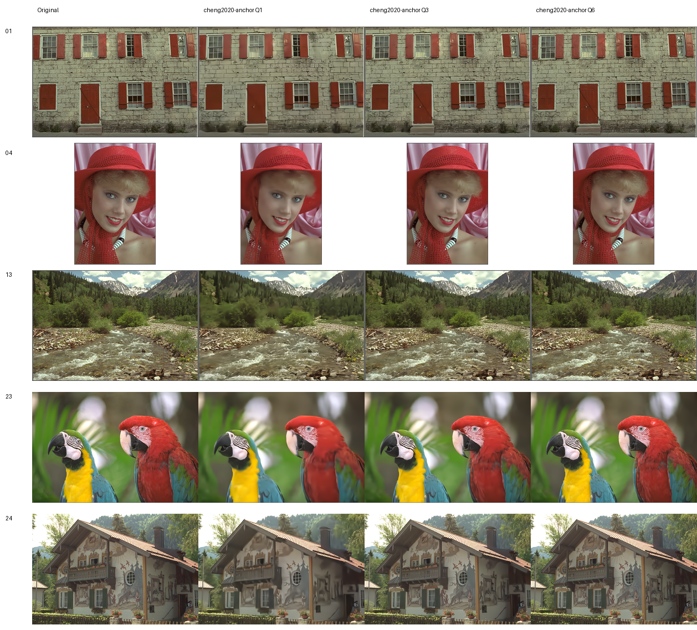

# 数字图像处理课程实习最终实验报告

姓名：__________
学号：__________
班级：__________
完成日期：2026 年 10 月 18 日
代码仓库：<https://github.com/xuntonghan/digital-image-proocess-work>

## 摘要

本项目围绕课程给出的三项任务，构建了从数据审计、传统基线、机器学习改进、客观评价到可视化交付的完整流程。第一项使用 SIED 极暗 RAW 数据完成可解释 ISP、Residual U-Net、ICCV 2025 SIED 作者模型和受限曝光色调精修；第二项使用 GeoCorrection 数据完成传统单应性、UVDoc 稠密展平、PageMaskUNet 页面分割与全自动几何纠正；第三项使用 Kodak 24 图完成 libjpeg、自研 DCTC v1/v2 和 CompressAI Cheng2020 真实熵码流压缩。

4090 最终实验中，Canon 图像增强达到 22.9980 dB、0.7868 SSIM 和 7.2288 ΔE2000；PageMaskUNet 在完全隔离的 22 张测试图上达到 0.9461 IoU、0.9693 Dice 和 0.7880 边界 F1，其预测遮罩驱动的全自动纠正将文本行平均倾斜角由 9.994° 降至 7.104°；Cheng2020 Q6 在 Kodak 上达到 0.8056 bpp、36.7047 dB 和 0.9469 SSIM。所有正式结果均保留逐图 CSV、汇总 JSON、固定数据清单和可视化；源码通过 101 项测试与静态检查。

**关键词**：极暗 RAW 增强；SIED；文档展平；页面分割；学习式图像压缩；可复现计算

## 1 任务目标与最终完成度

| 任务 | 课程要求 | 最终实现 | 状态 |
|---|---|---|---|
| 图像增强 | 数据读取、算法设计、增强、指标、可视化 | 传统 ISP、Residual U-Net、SIED 扩散模型、受限色调精修、全分辨率评价 | 已完成 |
| 几何纠正 | 倾斜、透视和曲面纠正、效果评价 | 单应性与边界展平、UVDoc、PageMaskUNet、预测遮罩全自动管线 | 已完成 |
| 图像压缩 | 压缩与解压、压缩比、质量和时间 | libjpeg、DCTC v1/v2、Cheng2020 真实码流、多码率率失真曲线 | 已完成 |
| 工程交付 | 可提交代码、复现说明、报告 | Python 包、CLI、配置、固定清单、测试、图表、Word/PDF 报告 | 已完成 |

本报告把“最佳版”定义为：在固定测试集上、按任务有效指标选择的最优可复现方案，而不是只挑选单张视觉效果最好的样例。训练集和验证集可参与权重选择，测试集只在最终阶段运行。

## 2 实验环境、数据和复现约束

### 2.1 计算环境

最终训练平台为 NVIDIA GeForce RTX 4090 24GB，Linux 5.15、Python 3.12.3、PyTorch 2.8.0+cu128。训练使用 BF16 或 FP16；本机复现与检查使用 Apple MPS。依赖和命令行入口由 `pyproject.toml` 统一管理。

### 2.2 固定数据划分

| 数据集 | 训练 | 验证 | 测试 | 用途 |
|---|---:|---:|---:|---|
| SIED Canon 0.0001 | 832 | 92 | 76 | 极暗 RAW 到 sRGB |
| SIED Sony 0.001 | 822 | 91 | 87 | 自研模型泛化验证 |
| GeoCorrection | 156 | 22 | 22 | 页面分割与全自动纠正 |
| Kodak | — | — | 24 | 无训练的压缩基准 |

SIED RAW 为 3840×2160、`uint16`，黑电平 512、白电平 16383。Canon 全部 1000 对经审计均存在、尺寸一致且无重复配对。GeoCorrection 的 200 对图像和页面遮罩采用按文件族分层的 156/22/22 划分。Kodak 24 张图只用于评价公开预训练压缩模型，没有参与其训练。

### 2.3 评价口径

- 图像增强：PSNR、SSIM、ΔE2000、亮度 MAE、饱和度 MAE、色相角误差；历史基线另报告 LPIPS。
- 页面分割：IoU、Dice、precision、recall、边界 F1。
- 几何纠正：边界 RMSE、页面填充率、文本行倾斜角和运行时间。没有平整真值时，不使用会惩罚正确坐标变化的 PSNR/SSIM。
- 图像压缩：实际压缩字节数、bpp、PSNR、SSIM、编码与解码时间。学习模型调用 `compress/decompress` 生成真实熵码流，不用理论似然值代替文件大小。

## 3 第一项：SIED 极暗 RAW 图像增强

### 3.1 数据读取和预处理

读取器先检查每个 RAW 的字节数，再完成黑电平扣除、白电平归一化和 RGGB 四通道打包。训练时从 RAW 和 GT 的对应位置裁剪 patch，并使用不破坏 Bayer 排列的几何增强。推理时先完成盲预测，之后才读取 GT 评价，避免答案图泄漏。

### 3.2 已实现方法

#### 3.2.1 自动传统 ISP

传统管线依次执行 RGGB 去马赛克、灰世界白平衡、高分位自动曝光、Gamma 映射和裁剪。它速度快、可解释，是判断学习模型是否真正有效的最低基线。

#### 3.2.2 Residual U-Net

自研网络输入四通道 RAW，通过编码器、跳跃连接和 PixelShuffle 输出 RGB。训练目标包含 RGB L1、SSIM 和 YCbCr 色度损失；4K 推理使用重叠分块和 Hann 融合减小接缝。

#### 3.2.3 SIED 官方模型

Canon 主模型固定使用 SIED 作者仓库提交 `fb7af94ac831e91c647415bf1ca0b1a75931833a` 和官方 EMA 权重。精简 EMA 文件 SHA256 为 `81b0215ef4729161fa7405c83063c29b387851de99d15017652067b92e888778`。每张测试图执行 20 步 DDIM，使用种子 3407 的三次独立采样均值，减少扩散采样波动。官方模型输出作为高质量基础图像。

#### 3.2.4 受限曝光和色调精修器

精修器不生成新纹理，只预测全局曝光、伽马、白平衡、3×3 颜色矩阵与平滑局部照度。它从恒等变换初始化，以 832 张训练图的盲预测训练，并在 92 张验证图上每 25 步选择权重。二阶段微调使用 batch size 8、BF16、初始学习率 `2e-5` 和 1500 步余弦衰减，最佳验证损失为 0.080319。最终精修权重 SHA256 为 `0428cdb082979ed960cfd5925a78ae558a635dfd8eaf0f783023272f65b27afa`。该约束使模型把容量集中在课程特别关心的亮度与色调，而不是重新学习完整 RAW 解码器。

### 3.3 最终结果

| 方法 | 子集 | 数量 | PSNR dB ↑ | SSIM ↑ | ΔE2000 ↓ | 说明 |
|---|---|---:|---:|---:|---:|---|
| 自动传统 ISP | Canon | 76 | 13.7400 | 0.1355 | 18.1816 | 灰世界自动参数 |
| Residual U-Net | Canon | 76 | 16.1234 | 0.6220 | 16.1650 | 本机 MPS 复现 |
| SIED EMA 三次平均 | Canon | 76 | 22.1682 | 0.7809 | 7.9648 | 冻结测试基线 |
| SIED + 最终精修器 | Canon | 76 | **22.9980** | **0.7868** | **7.2288** | 最终交付 |
| 自动传统 ISP | Sony | 87 | 14.2986 | 0.1642 | 18.6401 | 灰世界自动参数 |
| Residual U-Net | Sony | 87 | 17.0515 | 0.6333 | 15.6849 | 本机 MPS 复现 |

最终精修相对同批未精修 SIED 输出提升 0.8298 dB PSNR 和 0.005845 SSIM，平均 ΔE2000 降低 9.24%，亮度 MAE 从 7.8672 降至 6.8176。饱和度 MAE 从 0.06655 微升到 0.06701，色相误差增加 0.007°，因此结论是清晰度、亮度和总体色差显著改善，同时接受极小的饱和度取舍。相对上一版精修器，最终版再提升 0.0920 dB、0.00065 SSIM，ΔE2000 再降低 0.0873，故选为最终交付。



### 3.4 结论和局限

SIED 主模型对极端欠曝光的结构恢复明显强于传统 ISP 和课程规模 U-Net。受限精修器主要修正曝光与低频色调，不能恢复主模型已丢失的细节；因此最终采用与否由冻结测试决定，而不是根据训练损失主观选择。Sony 目前完成了可复现 U-Net 主线，但没有使用与 `0.001` 曝光档完全匹配的作者权重。

## 4 第二项：GeoCorrection 几何纠正

### 4.1 从 oracle 到全自动

早期传统方法使用数据集页面真值遮罩估计四角，属于 oracle-mask 设置，适合验证几何变换但不适合真实部署。最终版本新增 PageMaskUNet：输入 RGB 页面，输出概率遮罩；后处理保留最大连通域并填洞，再驱动四角检测、单应性、双轴边界展平和文字方向修正。由此推理时不再读取数据集遮罩。

### 4.2 PageMaskUNet 设计

模型采用轻量 U-Net 编码器—解码器、跳跃连接与双线性上采样，损失结合 BCE、Dice 和边界项。训练划分按七类文件族分层，避免同类命名样本全部集中到一个集合。最佳模型出现在第 72 轮。

| 分割集合 | 数量 | IoU ↑ | Dice ↑ | Precision ↑ | Recall ↑ | Boundary F1 ↑ |
|---|---:|---:|---:|---:|---:|---:|
| 验证 | 22 | 0.9681 | 0.9830 | 0.9903 | 0.9776 | 0.8549 |
| 测试 | 22 | **0.9461** | **0.9693** | **0.9540** | **0.9917** | **0.7880** |

模型高召回使页面主体很少被截断；边界 F1 低于区域指标，说明曲面、折痕和阴影边缘仍是主要误差来源。

### 4.3 Held-out 几何纠正结果

| 遮罩来源 | 数量 | 输入边界 RMSE ↓ | 输出边界 RMSE ↓ | 输出填充率 ↑ | 输入倾斜角 ↓ | 输出倾斜角 ↓ | 平均耗时 |
|---|---:|---:|---:|---:|---:|---:|---:|
| PageMaskUNet 预测 | 22 | 0.01885 | **0.01352** | 0.98287 | 9.994° | **7.104°** | 3.040 s |
| 数据集真值遮罩 | 22 | 0.00796 | **0.00040** | 0.99979 | 10.064° | **6.097°** | 2.991 s |

预测遮罩设置把平均文字倾斜减少约 28.9%，且实现完全自动推理。oracle 设置将边界 RMSE 降低约 94.9%、文字倾斜减少约 39.4%，反映出分割边界精度仍是自动版本和几何上限之间的主要差距。两个设置的“输入边界 RMSE”分别由不同遮罩测得，只应在各自设置内部比较，不应横向声称预测遮罩输入优于或劣于 oracle 输入。



### 4.4 与 UVDoc 路线的关系

UVDoc 稠密网格对页内非线性弯曲更有优势，旧版 200 图混合方案把文字倾斜从 7.597° 降到 5.113°，固定 40 图 OCR 诊断的高置信字符数提升 22.03%；但旧结果在裁剪阶段使用了数据集遮罩。最终版本把“是否可自动使用”和“曲面展平上限”分开报告：PageMaskUNet 管线是可部署主结果，UVDoc + oracle 边界精修保留为研究上限与后续组合方向。

## 5 第三项：Kodak 图像压缩

### 5.1 三类编解码器

1. `libjpeg`：工业基线，4:2:0 色度抽样，多质量档测试。
2. `DCTC`：项目自研独立码流，实现 RGB/YCbCr、8×8 DCT、量化、Zigzag、DC 差分、AC 零游程和 DEFLATE。v1 偏向码率；v2-fast 使用定长系数布局和快速压缩级别，偏向 Python 实现的延迟。
3. `Cheng2020`：CompressAI 官方预训练超先验与上下文模型，用 Kodak 仅作测试，调用真实 `compress/decompress`。

### 5.2 传统与自研结果

| 方法 | 档位 | bpp ↓ | PSNR dB ↑ | SSIM ↑ | 编码 ms ↓ | 解码 ms ↓ |
|---|---:|---:|---:|---:|---:|---:|
| libjpeg | Q70 | **1.2388** | **33.9167** | **0.9259** | **0.59** | **0.68** |
| DCTC v1 | Q70 | 1.4557 | 33.7403 | 0.9237 | 68.19 | 66.85 |
| DCTC v2-fast | Q70 | 1.9448 | 33.7403 | 0.9237 | 7.95 | 4.50 |

DCTC v1 比 v2-fast 节省约 25.2% 码率，但 Python 游程路径慢；v2-fast 把编码降到约 8 ms、解码降到约 4.5 ms，却以更大的码流换速度。libjpeg 在传统方案中仍提供最好的综合部署表现，这一负结果是合理且可复现的基线结论。

### 5.3 学习式真实码流结果

| 模型 | 质量档 | bpp ↓ | PSNR dB ↑ | SSIM ↑ | 编码 ms ↓ | 解码 ms ↓ |
|---|---:|---:|---:|---:|---:|---:|
| Cheng-A | 1 | **0.1196** | 28.5804 | 0.7655 | 2455.35 | 6525.77 |
| Cheng-A | 3 | 0.2709 | 31.3405 | 0.8573 | 2225.81 | 5775.78 |
| Cheng-A | 6 | 0.8056 | **36.7047** | **0.9469** | 2249.06 | 5784.88 |

在接近的质量比较中，Cheng Q3 相对 JPEG Q30 少用 58.94% bpp，同时 PSNR 高 0.849 dB；Cheng Q6 相对 JPEG Q70 少用 34.96% bpp，同时 PSNR 高 2.788 dB、SSIM 高 0.0210。因此 Cheng2020 是本项目率失真最优方案，Q3 是低码率交付档，Q6 是高质量交付档。另一方面，libjpeg 的编码和解码都低于 1 ms，而 Cheng 自回归模型需要约 2.2 秒编码和 5.8 秒解码；实时或 CPU 部署仍应选 libjpeg。





### 5.4 码率和时间的解释

学习式结果中的 bpp 只统计熵编码字符串负载，不包含模型权重；部署时编码端和解码端必须预先拥有同一模型。Cheng2020 的自回归熵模型在 CPU 上顺序运行，即使卷积放在 4090 上也可能比 libjpeg 慢很多。因而“率失真最好”和“端到端部署最快”是两个不同结论：课程实验应同时报告质量、码率和延迟。

## 6 工程实现与可提交文件

| 路径 | 作用 |
|---|---|
| `src/dip_course/enhancement/` | RAW 数据、U-Net、损失、颜色指标和精修器 |
| `src/dip_course/geocorrection/` | 页面分割、单应性、边界展平和可视化 |
| `src/dip_course/compression/` | DCTC 码流、指标和图表 |
| `src/dip_course/cli/` | 三项任务的训练、推理和评价入口 |
| `manifests/` | 固定训练、验证和测试清单 |
| `cloud/run_final_4090_pipeline.sh` | 4090 可恢复执行流水线 |
| `tests/` | 数据隔离、编解码往返、分割、评价和 CLI 测试 |
| `reports/assets/` | 汇总 JSON、逐图 CSV 和代表图 |

大型原始数据、官方权重、训练 checkpoint 和全量中间图不提交 Git。它们应放入文档指定目录，并用报告中的哈希或数据审计命令核验。

## 7 详细复现步骤

### 7.1 安装和自检

```bash
cd "/Users/hanxuntong/Documents/ChatGPT/cv宿題"
python3 -m venv .venv
source .venv/bin/activate
python -m pip install -U pip
python -m pip install -e '.[dev,perceptual,compression-ml]'
ruff check src tests scripts cloud
pytest -q
```

预期结果为静态检查通过、101 项测试通过。macOS 上若终端前缀已经显示 `(.venv)`，不要重复创建虚拟环境。

### 7.2 图像增强复现

```bash
dip-audit \
  --data-root data/SIED_dataset \
  --manifest manifests/source/canon_all.txt \
  --output-json outputs/audit/canon.json

dip-infer-official-sied \
  --official-repo third_party/SIED-official \
  --checkpoint checkpoints/official/canon_0.0001.pt \
  --refiner-checkpoint checkpoints/enhancement/canon_refiner_best.pt \
  --data-root data/SIED_dataset \
  --manifest manifests/enhancement/canon_test.txt \
  --output-dir outputs/enhancement/canon_final \
  --device cuda --precision fp16 \
  --sampling-steps 20 --ensemble-size 3 --seed 3407
```

没有 4090 时可将 `--device cuda` 改为 `mps` 或 `cpu`，但扩散推理会显著变慢。训练与完整云端顺序见 `cloud/run_final_4090_pipeline.sh`。

### 7.3 几何纠正复现

```bash
dip-train-page-segmentation \
  --data-root data/GeoCorrection \
  --output-dir outputs/geocorrection/page_mask_unet \
  --device cuda --precision bf16

dip-infer-page-segmentation \
  --data-root data/GeoCorrection \
  --checkpoint outputs/geocorrection/page_mask_unet/best.pt \
  --output-dir outputs/geocorrection/page_masks \
  --split all --device cuda --precision bf16

dip-rectify-classical \
  --data-root data/GeoCorrection \
  --mask-subdir outputs/geocorrection/page_masks/masks \
  --mask-source-label "PageMaskUNet predictions" \
  --output-dir outputs/geocorrection/automatic \
  --max-side 1400 --expected-count 200
```

正式测试结果必须使用训练时生成的 `split.json` 中 `test` 键对应的 22 张图；上面的 `all` 用于最终展示或部署演示，不可反过来用于选择权重。

### 7.4 图像压缩复现

```bash
dip-compress-benchmark \
  --data-dir data/kodak \
  --output-dir outputs/compression/jpeg

dip-dct-benchmark \
  --data-dir data/kodak \
  --output-dir outputs/compression/dctc_v2_fast \
  --stream-version 2 --zlib-level 1

dip-learned-compression-benchmark \
  --data-dir data/kodak \
  --output-dir outputs/compression/cheng2020_anchor \
  --architecture cheng2020-anchor \
  --qualities 1 3 6 --metric mse \
  --device cuda --repeats 1 --warmup 0 \
  --baseline-summary reports/assets/compression/jpeg_baseline/summary.json
```

每个输出目录都应包含 `metrics.csv`、`summary.json` 和 `comparison.png`；提供基线汇总时还会生成 `rate_distortion.png`。

## 8 可信度、失败实验与已知限制

- Canon 测试集 76 张、GeoCorrection 测试集 22 张均与训练和验证互斥；Kodak 未参与预训练模型的本项目再训练。
- 扩散模型的随机性通过固定种子和三次平均控制，但不同 CUDA/cuDNN 版本仍可能有末位差异。
- 传统 ISP、DCTC 和页面几何步骤均保留，是为了展示学习模型增益以及失败边界，而非只提交最优数字。
- GeoCorrection 没有平整 GT；边界与倾斜指标只能描述规整性，不能完全代表文字内容是否被局部拉伸。旧 OCR 数量是可读性诊断，不是字符错误率。
- 学习式压缩的码流测试不含模型权重和容器头开销；其解码器必须共享模型版本。
- 本项目使用公开研究权重；提交或公开再分发前应再次核对上游许可证。数据中的个人文档图像只用于课程实验，不应上传公共仓库。

## 9 下一步可提升方向

### 9.1 图像增强

- 在 Sony `0.001` 曝光档补齐匹配的官方权重与同等三次采样评价。
- 以场景亮度分层采样训练精修器，加入高光保护和 MacAdam/ΔE 约束，降低少数场景的色相回退。
- 对扩散模型进行少步蒸馏，比较 5、10、20 步的质量—时间曲线。

### 9.2 几何纠正

- 用预测遮罩作为 UVDoc 前后裁剪条件，把“完全自动”和“稠密曲面展平”合成同一条管线。
- 增加边界距离变换损失和困难样本重采样，优先提升曲面、折痕和阴影页面的边界 F1。
- 标注一小批平整 GT 或文字基线，报告网格误差和 OCR CER/WER，替代间接指标。

### 9.3 图像压缩

- 比较 Cheng2020 Attention、ELIC、TCM 或更新的公开权重，并报告相同硬件、相同真实码流口径。
- 为 DCTC 加入按频带 Huffman/ANS、量化表优化和 NumPy/C++ 向量化，分别解决码率和速度瓶颈。
- 把模型大小、冷启动、CPU 解码和峰值显存纳入部署评价。

## 10 结论

项目已完成三项课程任务，并把早期“能运行”的版本推进为可审计、可评价和可复现的最终版本。图像增强形成了传统 ISP—U-Net—SIED—受限精修的递进链；几何纠正用 PageMaskUNet 消除了真值遮罩依赖，并在隔离测试集上验证；图像压缩同时给出工业基线、自研码流和真实熵编码学习模型。所有优势和限制均按统一口径报告，源码、清单、测试和代表性实验资料可随仓库提交。
